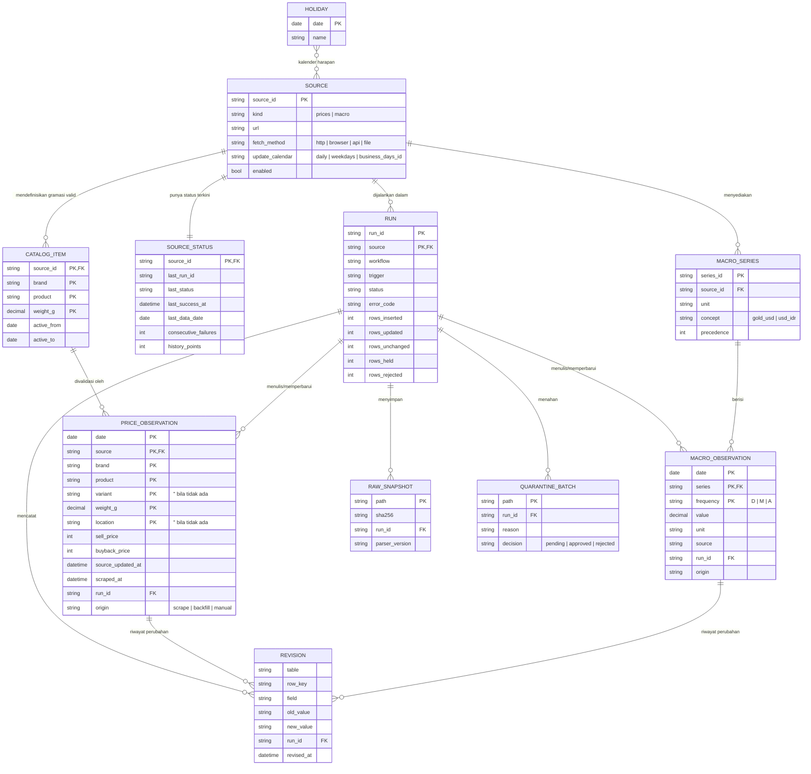

# Model Data

Acuan tunggal untuk skema, relasi, format file, dan aturan penulisan data. Dirujuk oleh [TECH-SPEC.md](./TECH-SPEC.md) dan [WORKFLOWS.md](./WORKFLOWS.md).

---

## 1. Lokasi data

Data dipisah menjadi dua jenis menurut **siapa yang menulis**:

| Folder | Ditulis oleh | Isi |
| --- | --- | --- |
| `config/` | Manusia, lewat PR | Konfigurasi sumber, katalog produk, kalender libur, anotasi peristiwa |
| `data/` | Bot (GitHub Actions) | Observasi harga, seri makro, arsip mentah, karantina, log run, status, revisi |

```
config/
  sources.yml                     # SOURCE + MACRO_SERIES
  catalog.yml                     # CATALOG_ITEM
  holidays.yml                    # HOLIDAY (libur nasional, diperbarui tahunan)
  events.yml                      # EVENT (anotasi grafik)
data/
  prices/{source}/{yyyy}.csv      # PRICE_OBSERVATION, partisi per tahun `date`
  macro/{series}.csv              # MACRO_OBSERVATION
  macro/spot.json                 # SPOT_SNAPSHOT (ditimpa setiap run makro)
  raw/{source}/{yyyy-mm}/{yyyy-mm-dd}T{HHMMSS}Z-{sha8}.{html|json}.gz   # RAW_SNAPSHOT
  quarantine/{source}/{yyyy-mm-dd}-{run_id}.json                      # QUARANTINE_BATCH (pending)
  quarantine/_resolved/…                                              # batch yang sudah diputuskan
  meta/
    status.json                   # SOURCE_STATUS
    runs/{yyyy}.jsonl             # RUN
    revisions/{yyyy}.jsonl        # REVISION
```

> Perubahan dari versi awal: `data/meta/sources.json` dipecah menjadi `config/sources.yml` (konfigurasi) dan `data/meta/status.json` (state bot); `products.json` → `config/catalog.yml`; `events.json` → `config/events.yml`; `runs.jsonl` dipartisi per tahun. Lihat D-13.

## 2. ERD



ERD ini **logis**: tidak ada database; setiap entitas adalah file (lihat §1). Kunci asing dijaga oleh validasi (`zod` + pemeriksaan katalog), bukan oleh mesin basis data.

## 3. Kamus data

### 3.1 `PRICE_OBSERVATION` — `data/prices/{source}/{yyyy}.csv`

Urutan kolom di CSV persis seperti tabel ini.

| # | Kolom | Tipe | Null | Contoh | Keterangan |
| --- | --- | --- | --- | --- | --- |
| 1 | `date` | `YYYY-MM-DD` | tidak | 2026-10-24 | Tanggal harga berlaku, Asia/Jakarta |
| 2 | `source` | enum | tidak | `ubslifestyle` | Lihat §3.6 |
| 3 | `brand` | enum | tidak | `ubs` | Lihat §3.6 |
| 4 | `product` | string | tidak | `gold_bar` | Lihat §3.6 |
| 5 | `variant` | string | `''` | `2026` | Tahun produksi buyback UBS; kosong untuk lainnya |
| 6 | `weight_g` | desimal kanonik | tidak | `0.5` | Lihat §4.2 |
| 7 | `location` | string | `''` | `jakarta` | `jakarta` untuk Logam Mulia; kosong untuk lainnya |
| 8 | `sell_price` | integer Rp | ya* | 1403300 | Toko menjual ke konsumen |
| 9 | `buyback_price` | integer Rp | ya* | 1145000 | Toko membeli dari konsumen |
| 10 | `source_updated_at` | ISO 8601 +07:00 | ya | 2026-10-24T10:12:08+07:00 | Waktu update yang tertera di sumber |
| 11 | `scraped_at` | ISO 8601 UTC | tidak | 2026-10-24T03:31:40Z | Waktu baris terakhir **diubah** (bukan waktu run terakhir) |
| 12 | `run_id` | string | tidak | `18734512345-1` | Run yang terakhir menyisipkan/mengubah baris |
| 13 | `origin` | enum | tidak | `scrape` | `scrape` · `backfill` · `manual` |

\* Minimal satu dari `sell_price` / `buyback_price` terisi (aturan V-01).

**Kunci utama:** `date, source, brand, product, variant, weight_g, location`.

### 3.2 `MACRO_OBSERVATION` — `data/macro/{series}.csv`

| # | Kolom | Tipe | Null | Contoh | Keterangan |
| --- | --- | --- | --- | --- | --- |
| 1 | `date` | `YYYY-MM-DD` | tidak | 2026-10-23 | `D`: tanggal perdagangan/penetapan; `M`: tanggal 1 bulan; `A`: 1 Januari |
| 2 | `series` | enum | tidak | `xau_usd_oz` | Lihat §3.6 |
| 3 | `frequency` | enum | tidak | `D` | `D` harian · `M` rata-rata bulanan · `A` rata-rata tahunan |
| 4 | `value` | desimal | tidak | 4120.55 | Maks. 6 angka desimal |
| 5 | `unit` | string | tidak | `USD/ozt` | `USD/ozt` · `IDR/USD` |
| 6 | `source` | string | tidak | `xaus` | `xaus` · `worldbank` · `bi` · `ecb` · `wdi` |
| 7 | `scraped_at` | ISO UTC | tidak | | Waktu baris terakhir diubah |
| 8 | `run_id` | string | tidak | | |
| 9 | `origin` | enum | tidak | `backfill` | |

**Kunci utama:** `date, series, frequency`.

### 3.3 `SPOT_SNAPSHOT` — `data/macro/spot.json`

```json
{ "fetched_at": "2026-10-24T09:41:10Z", "xau_usd_oz": 4125.3, "usd_idr": 16310.0,
  "usd_idr_series": "usd_idr_jisdor", "usd_idr_date": "2026-10-24", "source": "xaus", "stale": false }
```

Spot tidak masuk CSV harian (nilainya terus bergerak); dipakai sebagai titik terakhir bergaris putus di grafik kelipatan.

### 3.4 Tabel operasional

**`RUN`** — `data/meta/runs/{yyyy}.jsonl`, satu baris per sumber per run:

| Field | Contoh | Keterangan |
| --- | --- | --- |
| `run_id` | `18734512345-1` | `${GITHUB_RUN_ID}-${GITHUB_RUN_ATTEMPT}` |
| `source` | `logammulia` | |
| `workflow` | `scrape-retail` | |
| `trigger` | `schedule` | `schedule` · `workflow_dispatch` |
| `slot` | `primary` | `primary` · `retry` · `manual` · `backfill` |
| `started_at`, `finished_at` | ISO UTC | |
| `status` | `success` | Lihat §3.6 |
| `error_code` | `BLOCKED` | Lihat §3.6; kosong bila sukses |
| `error_message` | | Dipotong 500 karakter |
| `data_date` | `2026-10-24` | Tanggal data menurut sumber |
| `rows_parsed`, `rows_inserted`, `rows_updated`, `rows_unchanged`, `rows_held`, `rows_rejected` | int | `rows_parsed` = jumlah lima lainnya |
| `raw_paths` | `["data/raw/…gz"]` | Kosong bila konten sama dengan snapshot terakhir |
| `parser_version` | `ubslifestyle@1.2.0` | Versi modul parser |

**`SOURCE_STATUS`** — `data/meta/status.json`, objek per `source_id`: `last_run_id`, `last_status`, `last_success_at`, `last_data_date`, `consecutive_failures`, `history_points` (khusus Logam Mulia, untuk aturan V-07), `updated_at`.

**`REVISION`** — `data/meta/revisions/{yyyy}.jsonl`: `{ table, row_key, field, old_value, new_value, run_id, revised_at, reason }`. `reason`: `source_changed` · `quarantine_approved` · `reparse` · `manual`.

**`QUARANTINE_BATCH`** — `data/quarantine/{source}/{date}-{run_id}.json`: `{ run_id, source, reason_code, rows: [ … baris lengkap … ], decision: "pending" }`. Setelah diputuskan lewat workflow `quarantine.yml`, file dipindah ke `_resolved/` dengan `decision`, `decided_at`, `decided_by`.

### 3.5 Konfigurasi (`config/`)

**`sources.yml`**

```yaml
sources:
  - id: ubslifestyle
    kind: prices
    url: https://ubslifestyle.com/harga-buyback-hari-ini/
    fetch_method: http
    workflow: scrape-retail
    update_calendar: business_days_id   # situs tidak update di akhir pekan/libur
    stale_is_error_on_expected_day: true
    parser_version: 1.0.0
    enabled: true
  - id: logammulia
    kind: prices
    url: https://www.logammulia.com/id
    fetch_method: browser
    workflow: scrape-retail
    update_calendar: daily
    enabled: true
  # pegadaian, xaus, jisdor …
macro_series:
  - { id: xau_usd_oz,     concept: gold_usd, unit: USD/ozt, source: xaus,      precedence: 1 }
  - { id: usd_idr_jisdor, concept: usd_idr,  unit: IDR/USD, source: bi,        precedence: 1 }
  - { id: usd_idr_ecb,    concept: usd_idr,  unit: IDR/USD, source: ecb,       precedence: 2 }
  - { id: usd_idr_annual, concept: usd_idr,  unit: IDR/USD, source: wdi,       precedence: 3 }
```

Nilai `update_calendar` final per sumber ditetapkan dari observasi di Fase 0–1.

**`catalog.yml`** — gramasi valid per `source × brand × product`, dengan `active_from`/`active_to` agar gramasi baru atau yang dihentikan tidak memutus histori.

**`holidays.yml`** — daftar libur nasional dan cuti bersama per tahun (diperbarui setiap Januari dari SKB tiga menteri). Dipakai untuk menghitung hari yang "diharapkan ada data".

**`events.yml`** — `[{ date, label, kind: crisis|peak|policy|other }]`.

### 3.6 Enumerasi

| Enum | Nilai |
| --- | --- |
| `source` (harga) | `logammulia`, `pegadaian`, `ubslifestyle` |
| `source` (makro) | `xaus`, `worldbank`, `bi`, `ecb`, `wdi` |
| `brand` | `antam`, `ubs`, `galeri24` |
| `product` | `gold_bar` (default); varian lain ditambah lewat katalog, mis. `gold_bar_retro` |
| `series` | `xau_usd_oz`, `usd_idr_jisdor`, `usd_idr_ecb`, `usd_idr_annual` |
| `origin` | `scrape`, `backfill`, `manual` |
| `RUN.status` | `success` (semua baris ditulis/tak berubah) · `partial` (sebagian ditahan) · `stale` (sumber belum update) · `failed` · `skipped` (tidak perlu dijalankan) |
| `RUN.error_code` | `FETCH_HTTP`, `FETCH_TIMEOUT`, `BLOCKED`, `TOKEN_MISSING`, `PARSE_ERROR`, `SCHEMA_INVALID`, `VALIDATION_FAILED`, `STALE_SOURCE`, `UNKNOWN` |

## 4. Format dan normalisasi

### 4.1 CSV

UTF-8 tanpa BOM · pemisah koma · akhir baris LF · baris header wajib · kutip RFC 4180 hanya bila perlu · angka tanpa pemisah ribuan · null = string kosong · baris **diurutkan menurut kunci utama** agar diff Git stabil. `.gitattributes` memaksa `*.csv text eol=lf`.

### 4.2 Nilai kunci

- `weight_g` ditulis dalam bentuk desimal kanonik: titik sebagai pemisah, tanpa nol di belakang (`0.5`, `1`, `1000`, `0.05`). Fungsi `canonicalWeight()` di `packages/schema` menjadi satu-satunya jalur.
- Kolom kunci yang null ditulis sebagai string kosong, bukan `null`/`NA`, agar kunci selalu cocok.
- `variant` untuk UBS adalah tahun 4 digit sebagaimana label tabel.

### 4.3 Tanggal

- `date` selalu tanggal Asia/Jakarta menurut **sumber** (tanggal di halaman, atau timestamp endpoint yang dikonversi), bukan tanggal saat scraper berjalan.
- Logam Mulia: titik terakhir per tanggal Jakarta = harga penutupan. `source_updated_at` = timestamp terbaru di antara titik jual dan titik buyback yang terpilih.
- Makro `D`: tanggal perdagangan/penetapan menurut penyedia.

## 5. Aturan penulisan (merge)

Inilah yang membuat pipeline **idempoten** dan teraudit (D-14).

| Kasus | Tindakan |
| --- | --- |
| Kunci baru | **Insert**; `scraped_at` = sekarang, `run_id` = run ini |
| Kunci ada, kolom nilai sama (`sell_price`, `buyback_price`, `source_updated_at` / `value`) | **Tidak disentuh** — `scraped_at` dan `run_id` tetap. Dihitung `rows_unchanged` |
| Kunci ada, kolom nilai berbeda | **Update** + tulis `REVISION` per kolom yang berubah |
| Kunci ada di CSV tetapi tidak ada di hasil scrape | **Tidak dihapus** (ketiadaan ≠ penghapusan) |
| Banyak run di hari yang sama | Run terakhir menang lewat jalur update |
| Revisi histori besar (> 20 baris bertanggal < kemarin dalam satu run) | Seluruh run sumber itu **ditahan** ke karantina dengan alasan `MASS_REVISION` |

**Atomisitas per sumber (D-15):**

- Pelanggaran tingkat **run** (V-01 skema, V-03, V-04, V-07, V-10, atau salah satu endpoint Logam Mulia gagal) → tidak ada baris sumber itu yang ditulis; status `failed`.
- Pelanggaran tingkat **baris** (V-02 gramasi tak dikenal, V-05/V-08/V-09 lonjakan) → baris itu masuk karantina, sisanya ditulis; status `partial`.
- Arsip mentah ditulis untuk **semua** status (termasuk `failed`) agar kegagalan bisa didiagnosis — kecuali kontennya identik (sha256 sama) dengan snapshot terakhir sumber itu.

**Prioritas sumber di dalam satu `source`:** untuk Logam Mulia, harga 1 g dari endpoint grafik lebih diutamakan daripada tabel per gramasi (FR-04). Baris 1 g dari tabel dibuang; bila berbeda dari endpoint, dicatat sebagai peringatan di `RUN`.

## 6. Metrik turunan dan aturan penggabungan

Semua dihitung saat build (`packages/schema/src/derive.ts`), tidak disimpan.

### 6.1 Rumus

```
spread          = sell_price − buyback_price                (baris yang sama)
spread_pct      = spread / sell_price × 100
break_even_pct  = (sell_price − buyback_price) / buyback_price × 100
per_gram        = price / weight_g
gold_idr_gram   = xau_usd_oz × usd_idr / 31.1034768
index_t         = value_t / value_base
cagr            = index_end^(1/years) − 1
premium_antam   = sell_price(logammulia, antam, 1 g) / gold_idr_gram − 1
```

### 6.2 Penggabungan antar seri (*as-of join*, D-16)

| Kebutuhan | Aturan |
| --- | --- |
| Kurs untuk tanggal emas `d` | Seri `usd_idr` dengan `precedence` terkecil yang punya nilai pada tanggal terakhir ≤ `d`; toleransi 5 hari, selebihnya null |
| `premium_antam(d)` | `gold_idr_gram` pada tanggal terakhir **< d** (Antam menetapkan harga pagi berdasarkan penutupan sebelumnya); toleransi 5 hari |
| Spread lintas sumber | Cocokkan `brand + product + weight_g` pada tanggal yang sama. Untuk buyback UBS, default `variant` = tahun berjalan; pengguna bisa memilih tahun lain |
| Kalkulator, harga beli pada tanggal X | Nilai terakhir ≤ X (toleransi 7 hari); UI menampilkan tanggal yang benar-benar dipakai |
| *Forward-fill* | Hanya di tampilan, selalu diberi penanda; tidak pernah ditulis ke data |

### 6.3 Resolusi frekuensi untuk agregat tahunan/bulanan

Untuk setiap tahun (atau bulan) dan konsep (`gold_usd`, `usd_idr`): pakai data `D` bila cakupannya ≥ 80% hari kerja periode itu; jika tidak, rata-rata data `M`; jika tidak ada, nilai `A`. Untuk `usd_idr`, urutan seri mengikuti `precedence` (JISDOR → ECB → tahunan). Seri yang dipakai dicatat di output build agar tooltip bisa menyebut sumbernya.

## 7. Metrik kualitas data

- **Hari yang diharapkan** per sumber = hari sesuai `update_calendar` dikurangi `holidays.yml` (untuk `business_days_id`).
- **Kelengkapan(sumber, bulan)** = jumlah hari diharapkan yang punya baris data ÷ jumlah hari diharapkan.
- **Insiden** = run berstatus `failed` atau `partial` pada hari yang diharapkan.
- `stale` pada hari yang **tidak** diharapkan bukan insiden dan tidak memicu notifikasi.

## 8. Versi skema

`packages/schema` menyimpan `SCHEMA_VERSION` (semver). Penambahan kolom di **akhir** = minor; mengubah arti/urutan kolom = major dan wajib disertai skrip migrasi `scripts/migrate-<versi>.ts` yang menulis ulang CSV dalam satu commit. Versi tercatat di `public/data/meta.json`.
