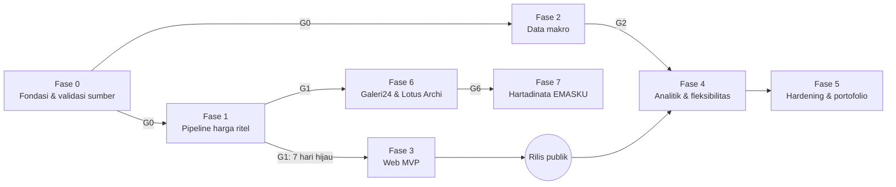

# Rencana Implementasi — Platform Harga Emas Historis

Folder ini adalah panduan implementasi proyek. Mulai dari PRD untuk memahami **apa** yang dibangun, lalu TECH-SPEC untuk **bagaimana**, lalu kerjakan fase satu per satu.

| File | Isi |
| --- | --- |
| [PRD.md](./PRD.md) | Tujuan, ruang lingkup, persona, kebutuhan fungsional (FR) dan non-fungsional (NFR), risiko |
| [TECH-SPEC.md](./TECH-SPEC.md) | Arsitektur, struktur repo, spesifikasi scraper, aturan validasi, build web, konvensi |
| [DATA-MODEL.md](./DATA-MODEL.md) | ERD, kamus data, format CSV, aturan merge, *as-of join*, metrik kualitas data |
| [WORKFLOWS.md](./WORKFLOWS.md) | YAML GitHub Actions, kontrak antar job, notifikasi, matriks kegagalan, kredensial, Vercel |
| [DECISIONS.md](./DECISIONS.md) | Log keputusan produk dan teknis |
| [phases/](./phases/) | Satu file per fase: tujuan, tugas, kriteria selesai, gerbang keluar |
| [research/](./research/) | Catatan riset sumber yang belum/baru masuk TECH-SPEC (Galeri24, Lotus Archi, Hartadinata) |
| [mockup/](./mockup/) | Mockup web semua halaman (acuan visual Fase 3–4): token desain, konvensi tampilan, pemetaan ke data nyata |

## Fase implementasi

| Fase | Fokus | Bergantung pada | Gerbang keluar | Perkiraan usaha* |
| --- | --- | --- | --- | --- |
| [0](./phases/fase-0-fondasi.md) | Monorepo, skema, CI, fixture, uji akses semua sumber | — | **G0** — semua sumber punya fixture dan cara fetch yang terbukti dari runner GitHub | 2–3 hari |
| [1](./phases/fase-1-pipeline-ritel.md) | Scraper UBS → Logam Mulia → Pegadaian, validasi, merge, workflow, notifikasi | G0 | **G1** — 7 hari berturut-turut run hijau, tidak ada data invalid ter-commit | 5–7 hari |
| [2](./phases/fase-2-data-makro.md) | XAU/USD, USD/IDR, backfill 1996+ | G0 (paralel dengan Fase 1) | **G2** — seri makro lengkap dan lolos cek silang | 3–4 hari |
| [3](./phases/fase-3-web-mvp.md) | Next.js, build-data, halaman Hari ini / Explorer / Spread / Data, deploy | G1 (pengembangan bisa mulai dengan fixture) | **G3** — rilis publik dengan data ≥ 14 hari | 5–7 hari |
| [4](./phases/fase-4-analitik.md) | Bandingkan, Kalkulator, grafik kelipatan, premi, mode nilai & agregasi, API statis | G2, G3 | **G4** — semua FR P1 selesai | 5–7 hari |
| [5](./phases/fase-5-hardening.md) | Reparse, halaman kualitas data, dokumentasi, studi kasus portofolio | G4 | **G5** — siap dipresentasikan | 3–5 hari |
| [6](./phases/fase-6-galeri24-lotus-archi.md) | Sumber `galeri24` (buyback Antam/UBS/Galeri24, menutup Q-1), brand Lotus Archi dari Galeri24, Pegadaian, dan lotusarchi.com | G1 (paralel dengan Fase 5; menggantikan P5-06) | **G6** — 7 hari run `galeri24` hijau, histori Galeri24 terisi, seri Lotus Archi tampil di web | 5–7 hari |
| [7](./phases/fase-7-hartadinata.md) | Sumber `hrtagold` (EMASKU, Hartadinata): jual + buyback per keping Gold 0,1–1.000 g dan Prime 25/50/100 g, satu request per hari, tampil di semua halaman web | G1, G6 (paralel dengan Fase 5) | **G7** — 7 hari run `hrtagold` hijau, jadwal/kalender final, seri EMASKU tampil di web tanpa menggeser sumber lain | 3–4 hari + observasi probe 5–7 hari |

\* Perkiraan kasar untuk satu pengembang penuh waktu; sesuaikan dengan ritme sendiri.

**Prinsip urutan:** pipeline data lebih dulu daripada tampilan. Setiap hari yang terlewat adalah histori ritel yang hilang permanen (kecuali Antam LM yang endpoint-nya memuat histori), sedangkan web bisa dibangun belakangan di atas data yang sudah terkumpul.

## Cara memakai dokumen fase

- Setiap tugas punya ID (`P1-05`) dan checkbox; centang di PR yang menyelesaikannya dan sebut ID di judul PR.
- Kolom **FR/NFR** menautkan tugas ke kebutuhan di PRD sehingga cakupan bisa ditelusuri.
- Fase dianggap selesai hanya bila **semua kriteria selesai** dan **gerbang keluar** terpenuhi.
- Keputusan baru selama implementasi dicatat di [DECISIONS.md](./DECISIONS.md).

## Status

| Fase | Status | Mulai | Selesai |
| --- | --- | --- | --- |
| 0 | 11/12 selesai; G0 terpenuhi untuk semua sumber (P0-09 ditutup: Logam Mulia jalan dari runner sejak 26 Okt, D-26). Sisa: P0-01 ruleset + LICENSE | 25 Okt 2026 | |
| 1 | 11/13 selesai (P1-01–P1-07, P1-09, P1-10, P1-12, P1-13); ketiga scraper aktif di `scrape-retail.yml` (Logam Mulia lewat stealth, D-26; run pertama di Actions sukses). P1-05 selesai (Telegram + Issue terbukti lewat `notify-test.yml`). **21 Nov 2026: 13/13, G1 terpenuhi** (P1-08 terbukti di run terjadwal, P1-11 observasi, Q-6 ditutup, D-68) | 26 Okt 2026 | |
| 2 | 13/13 selesai. Validasi + merge makro (D-35); histori makro ter-commit: `xau_usd_oz` bulanan 1996+ dan harian 5 tahun (P2-07, 6 Nov 2026), `usd_idr_ecb` 1999+, `usd_idr_jisdor` 2013+, `usd_idr_annual` 1996–1998. Scraper harian + `scrape-macro.yml` aktif (D-36). `check-macro` lulus pada data repo (D-37). Kriteria G2 terpenuhi; penutupan fase menunggu `scrape-macro` hijau 5 hari kerja (pertama 5 Nov 2026) | 1 Nov 2026 | |
| 3 | 11/12 selesai; situs tayang di <https://gold.hafidznrg.my.id> (P3-10, Q-5). Sisa P3-11: audit Lighthouse mobile. G3 menunggu data ritel ≥ 14 hari (±9 Nov) dan G1 | 1 Nov 2026 | |
| 4 | 13/13 selesai; P4-13 Kalkulator total harga beli yang bisa diubah + berat lain (FR-37, D-61, 15 Nov 2026). (P4-04 sudah terpenuhi oleh Spread P3-07): Explorer mode nilai/agregasi/isi celah, `derived/*`, Bandingkan + premi Antam sejak 2010 (D-38), Kelipatan, Kalkulator (D-39), API statis di README, fallback 1 g Logam Mulia. G4 menunggu audit Lighthouse mobile ulang di situs live (NFR-08) | 7 Nov 2026 | |
| 5 | Belum mulai | | |
| 6 | 17 Nov 2026: P6-01b–P6-05 dan P6-07–P6-13 selesai; `galeri24` dan `lotusarchi` aktif (histori Galeri24 47.569 baris, histori lotusarchi.com 489 tanggal). 21 Nov 2026: 13/14, P6-01 selesai dan jadwal final (D-68). Tersisa P6-06: pantau G6 7 hari (`galeri24` hijau 17–21 Nov, target 23 Nov) | 17 Nov 2026 | |
| 7 | 21 Nov 2026: 14/15 (P7-01–P7-07, P7-09–P7-14 selesai; D-69 final). `hrtagold` aktif sejak 21 Nov 2026 (commit `39fc66b`, run pertama 44869032220: 17 Gold + 3 Prime, 0 karantina) dan EMASKU tampil di semua halaman web. Tersisa P7-08 (jadwal/kalender final, Q-10, setelah observasi probe ±26–28 Nov) dan P7-15 (penutupan); G7: 7 hari run hijau dari 21 Nov, target ±28 Nov | 21 Nov 2026 | |

## Riwayat revisi

| Tanggal | Perubahan |
| --- | --- |
| 25 Okt 2026 | Versi awal PRD, TECH-SPEC, DECISIONS, rencana 6 fase |
| 25 Okt 2026 | Tinjauan skema & workflow: tambah DATA-MODEL.md dan WORKFLOWS.md; FR-15–17; D-13–D-17; tugas fase diselaraskan |
| 25 Okt 2026 | Fase 0: hasil riset sumber (P0-07–P0-11) masuk TECH-SPEC §5, PRD §6, DATA-MODEL; D-18–D-21; Q-1 temuan awal, Q-2 dan Q-4 terjawab |
| 26 Okt 2026 | Fase 1: inti pipeline (validate, merge), scraper UBS, workflow `scrape-retail.yml`; D-22 |
| 26 Okt 2026 | P1-07 scraper Pegadaian; temuan harga Minggu periode I (TECH-SPEC §5.2, Q-6); D-23 |
| 26 Okt 2026 | Logam Mulia versi baru memblokir akses otomatis; harga-emas.org dievaluasi; D-24 |
| 26 Okt 2026 | Logam Mulia diaktifkan lewat Playwright + stealth (D-26) |
| 26 Okt 2026 | Pegadaian: endpoint = snapshot harian ±18.32 WIB → jendela malam `scrape-retail` (19.05/21.05 WIB), field `schedule_window`; D-25 |
| 27 Okt 2026 | Cron GitHub terlambat 5,7–6,9 jam → tanggal sasaran dari jadwal cron (`plan` output `date`); D-27. P1-05 Telegram + Issue terimplementasi (menunggu bot) |
| 31 Okt 2026 | P1-05 terbukti (`notify-test.yml`); P1-12 karantina: perintah `quarantine` + `quarantine.yml`; P1-13 kerangka `backfill` + `backfill.yml`; P1-09 backfill buyback 1 g UBS sejak Nov 2023 (543 baris, D-28) |
| 31 Okt 2026 | P1-10 README Operasional; histori LM 1 g sejak 2010 dari arsip (D-29); Pegadaian Tabungan Emas + backfill 360 hari (D-30) |
| 1 Nov 2026 | Fase 2 mulai: `derive.ts` (P2-11, D-31), job backfill ecb/worldbank/jisdor/annual-fx (P2-06/08/09/10, D-32, D-33; Q-3 terjawab), `config/events.yml` (P2-13). P0-09 ditutup, G0 lengkap |
| 1 Nov 2026 | Tambah `mockup/`: mockup 7 halaman web (Hari ini, Explorer, Spread, Data, Bandingkan, Kalkulator, Kelipatan) termasuk Tabungan Emas; FR-20/23/30 dan tugas fase 3–4 diselaraskan (D-34) |
| 1 Nov 2026 | Fase 3 mulai: P3-01–P3-04 (`apps/web` Next.js 16 + tema mockup, `build-data`, `lib/data`, `components/charts`) |
| 1 Nov 2026 | Gelombang 3a: komponen bersama (`SourceStamp`, `RangeControl`, `Segmented`, chip data di header) dan halaman Data (P3-08); jam Pegadaian = waktu terbit harga, bukan snapshot |
| 1 Nov 2026 | Gelombang 4: smoke test Playwright di CI (P3-11), audit atribusi (P3-09), metadata/OG/ikon (P3-12), LICENSE MIT |
| 1 Nov 2026 | Situs tayang di gold.hafidznrg.my.id lewat Vercel (P3-10, Q-5 terjawab); README menautkan situs (P3-12). Perbaikan: celah grafik mengikuti kalender terbit sumber; `apps/web/lib/build` sebelumnya terabaikan `.gitignore` |
| 5 Nov 2026 | Fase 2: `backfill/xaus.ts` (P2-07, belum dijalankan non-dry) dan `check-macro` (P2-12, D-37); evaluasi G2 di fase-2-data-makro.md |
| 17 Nov 2026 | Rencana Fase 6: riset Galeri24 (`research/galeri24.md`) dan Lotus Archi (`research/lotusarchi.md`), `phases/fase-6-galeri24-lotus-archi.md`; Q-7 (backfill histori Galeri24) disetujui, P6-12 (Antam non-Pegadaian) masuk fase |
| 17 Nov 2026 | Fase 6 G1–G6: skema (brand `lotusarchi`, varian `non_pegadaian`, `PRICE_FORMULA`), scraper `galeri24` (V-12), Lotus Archi di Pegadaian (`pegadaian@1.2.0`), aktivasi `galeri24`, backfill histori Galeri24 (47.569 baris, 1 Feb 2024–16 Nov 2026) dan Lotus Archi dari arsip raw Pegadaian (138 baris). D-64, D-65 |
| 17 Nov 2026 | Mockup diselaraskan dengan design system Momen Emas dan situs live; perbaikan halaman Spread |
| 17 Nov 2026 | P6-10 web: Galeri24 dan Lotus Archi di Hari ini, Data, Spread, Bandingkan, Riwayat harga, Kalkulator, header/footer |
| 17 Nov 2026 | P6-09 scraper `lotusarchi` dari lotusarchi.com lewat dua endpoint JSON (`harga-display` + `harga-gold`; dua request per run, penyimpangan NFR-12 disetujui pemilik, D-65) |
| 17 Nov 2026 | Backfill `lotusarchi-history`: 489 tanggal 1 g (jual + buyback) 27 Feb 2025–17 Nov 2026 dari `harga-gold` (satu request, tanggal ganda → `harga_id` terbesar); asumsi `harga_emas` = harga jual keping 1 g; katalog 1 g `active_from: 2025-02-27` |
| 21 Nov 2026 | P1-08, P1-11 ditutup (G1 terpenuhi, Q-6 terjawab); P6-01 ditutup: observasi jam terbit selesai, kalender `lotusarchi` → `business_days_id` + alarm stale aktif, `schedule:` probe.yml dicabut (D-68) |
| 21 Nov 2026 | Rencana Fase 7: riset Hartadinata/EMASKU (`research/hartadinata.md`, endpoint `hrtagold.id/api/v1/brandings/price/daily`), `phases/fase-7-hartadinata.md` (P7-01–P7-15, G7); PRD Q-8 (histori), Q-9 (PPh Harga Dasar), Q-10 (jadwal/kalender); draf D-69 |
| 21 Nov 2026 | Fase 7 aktif (P7-14): D-69 final (EMASKU/`hrtagold`; Q-8 tanpa histori, Q-9 harga sudah termasuk pajak, Q-11 pemilik menerima risiko klausul §9; Q-10 terbuka), TECH-SPEC §5.9, DATA-MODEL §3.6 (`emasku`, `prime`), PRD §6/§13/§16 (v1.5), README repo; catatan: `updated_date` bergeser intraday, slot final diputuskan di P7-08 |
