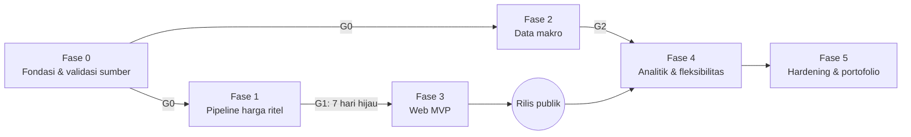

# Rencana Implementasi — Platform Harga Emas Historis

Folder ini adalah panduan implementasi proyek. Mulai dari PRD untuk memahami **apa** yang dibangun, lalu TECH-SPEC untuk **bagaimana**, lalu kerjakan fase satu per satu.

| File | Isi |
| --- | --- |
| [PRD.md](./PRD.md) | Tujuan, ruang lingkup, persona, kebutuhan fungsional (FR) dan non-fungsional (NFR), risiko |
| [TECH-SPEC.md](./TECH-SPEC.md) | Arsitektur, struktur repo, spesifikasi scraper, aturan validasi, build web, konvensi |
| [DATA-MODEL.md](./DATA-MODEL.md) | ERD, kamus data, format CSV, aturan merge, *as-of join*, metrik kualitas data |
| [WORKFLOWS.md](./WORKFLOWS.md) | YAML GitHub Actions, kontrak antar job, notifikasi, matriks kegagalan, kredensial, Vercel |
| [DECISIONS.md](./DECISIONS.md) | Log keputusan produk dan teknis |
| [phases/](./phases/) | Satu file per fase: tujuan, tugas, kriteria selesai, gerbang keluar |

## Fase implementasi

| Fase | Fokus | Bergantung pada | Gerbang keluar | Perkiraan usaha* |
| --- | --- | --- | --- | --- |
| [0](./phases/fase-0-fondasi.md) | Monorepo, skema, CI, fixture, uji akses semua sumber | — | **G0** — semua sumber punya fixture dan cara fetch yang terbukti dari runner GitHub | 2–3 hari |
| [1](./phases/fase-1-pipeline-ritel.md) | Scraper UBS → Logam Mulia → Pegadaian, validasi, merge, workflow, notifikasi | G0 | **G1** — 7 hari berturut-turut run hijau, tidak ada data invalid ter-commit | 5–7 hari |
| [2](./phases/fase-2-data-makro.md) | XAU/USD, USD/IDR, backfill 1996+ | G0 (paralel dengan Fase 1) | **G2** — seri makro lengkap dan lolos cek silang | 3–4 hari |
| [3](./phases/fase-3-web-mvp.md) | Next.js, build-data, halaman Hari ini / Explorer / Spread / Data, deploy | G1 (pengembangan bisa mulai dengan fixture) | **G3** — rilis publik dengan data ≥ 14 hari | 5–7 hari |
| [4](./phases/fase-4-analitik.md) | Bandingkan, Kalkulator, grafik kelipatan, premi, mode nilai & agregasi, API statis | G2, G3 | **G4** — semua FR P1 selesai | 5–7 hari |
| [5](./phases/fase-5-hardening.md) | Reparse, halaman kualitas data, dokumentasi, studi kasus portofolio | G4 | **G5** — siap dipresentasikan | 3–5 hari |

\* Perkiraan kasar untuk satu pengembang penuh waktu; sesuaikan dengan ritme sendiri.

**Prinsip urutan:** pipeline data lebih dulu daripada tampilan. Setiap hari yang terlewat adalah histori ritel yang hilang permanen (kecuali Antam LM yang endpoint-nya memuat histori), sedangkan web bisa dibangun belakangan di atas data yang sudah terkumpul.

## Cara memakai dokumen fase

- Setiap tugas punya ID (`P1-05`) dan checkbox; centang di PR yang menyelesaikannya dan sebut ID di judul PR.
- Kolom **FR/NFR** menautkan tugas ke kebutuhan di PRD sehingga cakupan bisa ditelusuri.
- Fase dianggap selesai hanya bila **semua kriteria selesai** dan **gerbang keluar** terpenuhi.
- Keputusan baru selama implementasi dicatat di [DECISIONS.md](./DECISIONS.md).

## Status

| Fase | Status | Mulai | Selesai |
| --- | --- | --- | --- |
| 0 | 10/12 selesai; G0 terpenuhi kecuali Logam Mulia (P0-09 tertahan: situs maintenance). Sisa: P0-01 ruleset + LICENSE | 25 Okt 2026 | |
| 1 | 5/13 selesai (P1-01–P1-04, P1-07); UBS Lifestyle dan Pegadaian aktif di `scrape-retail.yml`; P1-06 Logam Mulia tertahan (D-24). P1-08 terimplementasi, P1-05 sebagian (step summary) | 26 Okt 2026 | |
| 2 | Belum mulai | | |
| 3 | Belum mulai | | |
| 4 | Belum mulai | | |
| 5 | Belum mulai | | |

## Riwayat revisi

| Tanggal | Perubahan |
| --- | --- |
| 25 Okt 2026 | Versi awal PRD, TECH-SPEC, DECISIONS, rencana 6 fase |
| 25 Okt 2026 | Tinjauan skema & workflow: tambah DATA-MODEL.md dan WORKFLOWS.md; FR-15–17; D-13–D-17; tugas fase diselaraskan |
| 25 Okt 2026 | Fase 0: hasil riset sumber (P0-07–P0-11) masuk TECH-SPEC §5, PRD §6, DATA-MODEL; D-18–D-21; Q-1 temuan awal, Q-2 dan Q-4 terjawab |
| 26 Okt 2026 | Fase 1: inti pipeline (validate, merge), scraper UBS, workflow `scrape-retail.yml`; D-22 |
| 26 Okt 2026 | P1-07 scraper Pegadaian; temuan harga Minggu periode I (TECH-SPEC §5.2, Q-6); D-23 |
| 26 Okt 2026 | Logam Mulia versi baru memblokir akses otomatis; harga-emas.org dievaluasi; D-24 |
