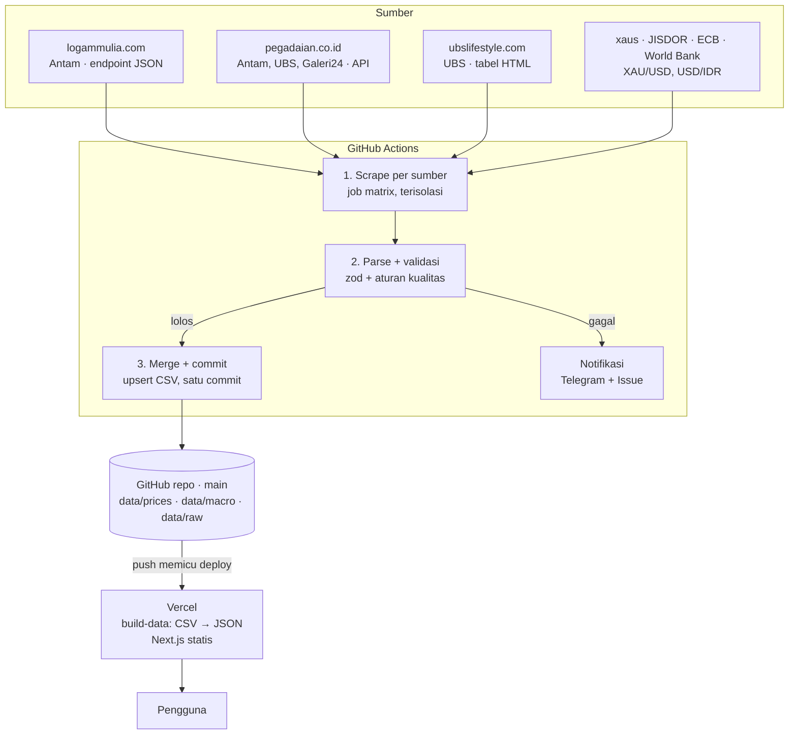

# Spesifikasi Teknis — Platform Harga Emas Historis

Pendamping [PRD.md](./PRD.md). Dokumen ini menjelaskan **bagaimana** sistem dibangun: arsitektur, struktur repo, spesifikasi tiap scraper, aturan validasi, build web, dan konvensi. Detail skema, ERD, dan aturan tulis ada di [DATA-MODEL.md](./DATA-MODEL.md); detail workflow dan deploy ada di [WORKFLOWS.md](./WORKFLOWS.md).

---

## 1. Arsitektur



Prinsip:

1. **Simpan mentah, olah belakangan.** Fragmen mentah disimpan agar data bisa di-parse ulang.
2. **Idempoten.** Upsert berdasarkan kunci unik.
3. **Gagal dengan keras.** Exit code non-nol; tidak ada penulisan data bila validasi gagal.
4. **Skema dulu.** Satu skema `zod` dipakai scraper dan web.
5. **Statis sebisa mungkin.** Komputasi turunan saat build atau di browser.

## 2. Stack

| Lapisan | Pilihan |
| --- | --- |
| Monorepo | pnpm workspaces |
| Bahasa | TypeScript (strict) dari ujung ke ujung |
| Runtime scraper | Node.js 22 + `tsx` |
| HTTP + parsing | `fetch` bawaan + `cheerio` |
| Browser headless | Playwright + `playwright-extra` + `puppeteer-extra-plugin-stealth` |
| Validasi | `zod` |
| CSV | `csv-parse` / `csv-stringify` |
| Tanggal | `date-fns` + `date-fns-tz` (zona `Asia/Jakarta` eksplisit) |
| XLS (backfill World Bank) | `xlsx` (SheetJS) |
| Scheduler | GitHub Actions |
| Web | Next.js (App Router), static export / SSG |
| Grafik | Apache ECharts via `echarts-for-react` |
| UI | Tailwind CSS + shadcn/ui |
| State URL | `nuqs` |
| Uji | Vitest (+ Playwright Test untuk smoke test web) |
| Lint/format | ESLint + Prettier (atau Biome) |
| Hosting | Vercel (Hobby) |
| Notifikasi | Bot Telegram + GitHub Issues |

## 3. Struktur repository

```
gold-price-tracker/
  .github/
    actions/setup/action.yml   # node + pnpm + install
    workflows/                 # ci, probe, scrape-retail, scrape-macro, backfill, quarantine, freshness
  config/                      # ditulis manusia (PR)
    sources.yml                # sumber, kalender update, seri makro
    catalog.yml                # gramasi valid per sumber × brand × produk
    holidays.yml               # libur nasional per tahun
    events.yml                 # anotasi peristiwa untuk grafik
  data/                        # ditulis bot
    prices/{source}/{yyyy}.csv
    macro/{series}.csv
    macro/spot.json
    raw/{source}/{yyyy-mm}/{yyyy-mm-dd}T{HHMMSS}Z-{sha8}.{html|json}.gz
    quarantine/{source}/…json
    meta/status.json
    meta/runs/{yyyy}.jsonl
    meta/revisions/{yyyy}.jsonl
  packages/
    schema/                    # zod schema, enum, normalisasi, derive.ts, SCHEMA_VERSION
  apps/
    scraper/
      src/sources/             # ubslifestyle, pegadaian, logammulia, xaus, jisdor, worldbank
      src/backfill/            # worldbank, xaus, ecb, jisdor, annual-fx, ubs-history
      src/pipeline/            # plan, validate, merge, quarantine, notify, freshness
      src/cli.ts               # plan | scrape | merge | backfill | quarantine | reparse | probe | notify | freshness
      test/fixtures/{source}/
    web/
      scripts/build-data.ts    # CSV → public/data/*.json
      app/                     # /, /explorer, /spread, /bandingkan, /kalkulator, /kelipatan, /data, /kualitas
  plan/                        # dokumen perencanaan
  .gitattributes  .gitignore  .nvmrc  package.json  pnpm-workspace.yaml
```

Kontrak setiap modul sumber:

```ts
export interface SourceScraper<Row> {
  id: SourceId;                                     // 'ubslifestyle' | 'pegadaian' | 'logammulia' | 'xaus' | 'jisdor' | 'worldbank'
  kind: 'prices' | 'macro';
  parserVersion: string;                            // dicatat di RUN dan RAW_SNAPSHOT
  fetchRaw(ctx: FetchContext): Promise<RawPayload>; // { body, contentType, fetchedAt }
  parse(raw: RawPayload): ParseResult<Row>;         // fungsi murni: { rows, dataDate, sourceUpdatedAt }
}
```

Hasil scrape mengikuti kontrak artifact di [WORKFLOWS.md §2.1](./WORKFLOWS.md#21-kontrak-antar-job).

## 4. Model data

Ringkasan; definisi lengkap, ERD, kamus data, format CSV, aturan merge, dan aturan *as-of join* ada di [DATA-MODEL.md](./DATA-MODEL.md).

| Entitas | File | Kunci utama |
| --- | --- | --- |
| `PRICE_OBSERVATION` | `data/prices/{source}/{yyyy}.csv` | `date, source, brand, product, variant, weight_g, location` |
| `MACRO_OBSERVATION` | `data/macro/{series}.csv` | `date, series, frequency` |
| `SPOT_SNAPSHOT` | `data/macro/spot.json` | — (satu snapshot, ditimpa) |
| `RUN` | `data/meta/runs/{yyyy}.jsonl` | `run_id, source` |
| `SOURCE_STATUS` | `data/meta/status.json` | `source_id` |
| `REVISION` | `data/meta/revisions/{yyyy}.jsonl` | — (log tambah-saja) |
| `QUARANTINE_BATCH` | `data/quarantine/{source}/{date}-{run_id}.json` | path |
| `RAW_SNAPSHOT` | `data/raw/{source}/{yyyy-mm}/…gz` | path (berisi sha256) |
| `SOURCE`, `MACRO_SERIES` | `config/sources.yml` | `id` |
| `CATALOG_ITEM` | `config/catalog.yml` | `source, brand, product, weight_g` |
| `HOLIDAY`, `EVENT` | `config/holidays.yml`, `config/events.yml` | `date` |

Tiga aturan yang paling menentukan perilaku pipeline:

1. **Upsert berbasis nilai.** Baris yang nilainya tidak berubah tidak disentuh sama sekali (termasuk `scraped_at`), sehingga run berulang tidak menghasilkan diff. Nilai yang berubah ditulis dan dicatat di `REVISION`.
2. **Ketiadaan ≠ penghapusan.** Scraper tidak pernah menghapus baris.
3. **Atomik per sumber, karantina per baris.** Pelanggaran tingkat run menggagalkan seluruh sumber; pelanggaran tingkat baris hanya menahan baris itu.

## 5. Spesifikasi scraper per sumber

### 5.1 UBS Lifestyle (`ubslifestyle.ts`)

- **Fetch:** `GET https://ubslifestyle.com/harga-buyback-hari-ini/`, User-Agent mencantumkan URL repo.
- **Parse (cheerio):** baca tanggal & jam di blok "Updated" → `source_updated_at`. Untuk setiap tabel per tahun ("Tahun 2026", dst.): kolom "Harga Beli" → `sell_price`, "Harga Jual (Buyback)" → `buyback_price`, label tahun → `variant`.
- **Normalisasi:** `Rp1.403.300` → `1403300`; `0.05 Gram` / `0,5 Gram` → `0.05` / `0.5`.
- **Validasi khusus:** ≥ 13 pecahan untuk tahun berjalan; tanggal di halaman = hari ini. Jika tidak: `stale` — dianggap kegagalan hanya pada hari yang diharapkan menurut `update_calendar` (situs tidak update di akhir pekan/libur).
- **Riset (Fase 0):** cek tab Network apakah grafik 7H–3T memuat endpoint JSON → bahan backfill (FR-08).

### 5.2 Pegadaian (`pegadaian.ts`)

- **Riset (Fase 0):** buka `https://pegadaian.co.id/harga-emas` di DevTools → Network → temukan request XHR/fetch yang mengembalikan harga. Catat URL, method, header wajib, bentuk respons.
- **Fetch utama:** panggil endpoint itu langsung dengan `fetch`.
- **Fallback:** Playwright membuka halaman, tunggu tabel harga ter-render, baca DOM.
- **Parse:** per brand (Antam, UBS, Galeri24) per gramasi → `sell_price`; buyback diisi bila ada, kosong bila tidak.
- **Validasi khusus:** setiap brand punya ≥ 5 gramasi.

### 5.3 Logam Mulia / Antam (`logammulia.ts`)

1. Chromium headless via `playwright-extra` + plugin stealth.
2. `goto('https://www.logammulia.com/id', { waitUntil: 'networkidle', timeout: 60_000 })`.
3. Token: `page.inputValue('input[name="_token"]')`.
4. Dari dalam konteks halaman (`page.evaluate` + `fetch`), header `Accept: application/json`, `X-Requested-With: XMLHttpRequest`, jeda 5 detik antar panggilan:
   - jual: `/data-base-price/gold_eai/sell?_token=<token>&transition=1`
   - buyback: `/data-base-price/gold/buy?_token=<token>`
5. Respons: `[timestamp_ms, harga][]` untuk 1 g (jual sejak Jan 2010 ±5.150 titik; buyback sejak Nov 2015 ±3.600 titik, per 23 Okt 2026).
6. Normalisasi: timestamp → tanggal `Asia/Jakarta`; titik terakhir per hari = penutupan; `brand=antam`, `product=gold_bar`, `weight_g=1`, `location=jakarta`. Jual dan buyback digabung per tanggal menjadi satu baris; tanggal sebelum Nov 2015 hanya berisi `sell_price`. `source_updated_at` = timestamp terbaru dari kedua titik terpilih.
7. Kedua endpoint harus sukses; bila salah satu gagal, seluruh run gagal (atomik).
8. Merge menulis hanya tanggal baru/berubah (DATA-MODEL §5). Raw mentah disimpan hanya bila sha256 berbeda dari snapshot terakhir. Revisi > 20 baris histori dalam satu run → karantina `MASS_REVISION`.

```ts
import { chromium } from 'playwright-extra';
import stealth from 'puppeteer-extra-plugin-stealth';

chromium.use(stealth());
const browser = await chromium.launch({ headless: true });
const page = await browser.newPage();
await page.goto('https://www.logammulia.com/id', { waitUntil: 'networkidle', timeout: 60_000 });
const token = await page.inputValue('input[name="_token"]');

const getSeries = (url: string) =>
  page.evaluate(async (u) => {
    const res = await fetch(u, { headers: { Accept: 'application/json', 'X-Requested-With': 'XMLHttpRequest' } });
    if (!res.ok) throw new Error(`HTTP ${res.status}`);
    return (await res.json()) as [number, number][];
  }, url);

const sell = await getSeries(`/data-base-price/gold_eai/sell?_token=${token}&transition=1`);
await page.waitForTimeout(5_000);
const buyback = await getSeries(`/data-base-price/gold/buy?_token=${token}`);
await browser.close();
```

**Aturan wajib:** exit non-nol bila token tidak ada / HTTP ≠ 200 / respons bukan array JSON; titik terakhir ≤ 3 hari; jumlah titik histori tidak menyusut dibanding run sebelumnya; tidak ada sumber pengganti bila gagal.

### 5.4 XAU/USD (`xaus.ts`)

- Harian: `GET https://xaus.com/api/v1/history` → ambil penutupan **10 hari terakhir** dan upsert semuanya (menutup akhir pekan, libur, dan run yang terlewat; baris yang sama tidak disentuh). Penutupan hari berjalan tidak diambil karena belum final.
- Spot: `GET https://xaus.com/api/v1/spot?compact=1` → ditimpa ke `data/macro/spot.json` (tidak masuk CSV), dipakai sebagai titik bergaris putus.
- Tolak respons dengan `stale: true`.

### 5.5 USD/IDR JISDOR (`jisdor.ts`)

- Sumber: halaman histori JISDOR di bi.go.id (terbit 15.15 WIB hari kerja). **Riset Fase 0:** tentukan cara ambil paling stabil (form query, ekspor, atau parse tabel).
- Setiap run mengambil **10 hari terakhir** dan meng-upsert semuanya.
- Fallback harian bila BI tidak dapat diakses: Frankfurter `usd_idr_ecb` (disimpan sebagai seri terpisah, bukan menimpa JISDOR).

### 5.6 Backfill makro (sekali jalan)

| Skrip | Sumber | Seri | Rentang |
| --- | --- | --- | --- |
| `backfill/worldbank.ts` | Pink Sheet XLS (monthly) | `xau_usd_oz` frekuensi `M` | 1996 → bulan lalu |
| `backfill/xaus.ts` | `/api/v1/history` | `xau_usd_oz` frekuensi `D` | 5 tahun terakhir |
| `backfill/ecb.ts` | Frankfurter `rates.csv?base=eur&providers=ecb` | `usd_idr_ecb` = EUR/IDR ÷ EUR/USD | Feb 1999 → kini |
| `backfill/jisdor.ts` | Histori JISDOR | `usd_idr_jisdor` | 20 Mei 2013 → kini |
| `backfill/annual-fx.ts` | File statis terverifikasi | `usd_idr_annual` | 1996–1998 |

## 6. Pipeline

Ringkasan; YAML lengkap, kontrak antar job, logika slot, notifikasi, matriks kegagalan, kredensial, dan pengaturan Vercel ada di [WORKFLOWS.md](./WORKFLOWS.md).

| Workflow | Jadwal (WIB) | Isi |
| --- | --- | --- |
| `scrape-retail.yml` | 10.25 (primary), 13.25 (retry) | UBS Lifestyle, Pegadaian, Logam Mulia |
| `scrape-macro.yml` | 16.40 hari kerja | xaus, JISDOR (+ World Bank bulanan) |
| `freshness.yml` | 19.15 | Deteksi sumber/workflow berhenti |
| `backfill.yml`, `quarantine.yml`, `probe.yml` | Manual | Histori, tinjauan karantina, uji sumber |
| `ci.yml` | PR / push kode | Lint, typecheck, test, build |

Alur setiap workflow penulis data: `plan → scrape (matrix per sumber) → merge + commit → notify`, dengan `concurrency: data-write` agar hanya ada satu penulis.

## 7. Aturan validasi (gerbang kualitas)

Tingkat **run** = seluruh hasil sumber itu tidak ditulis (`failed`). Tingkat **baris** = baris itu masuk karantina, sisanya ditulis (`partial`). Lihat DATA-MODEL §5.

| Kode | Aturan | Berlaku untuk | Tingkat | Bila gagal |
| --- | --- | --- | --- | --- |
| V-01 | Lolos skema `zod` (tipe, kolom wajib, enum, minimal satu harga terisi) | Semua | Run | `SCHEMA_INVALID` |
| V-02 | `source × brand × product × weight_g` ada di `config/catalog.yml` dan aktif | Harga ritel | Baris | Karantina `UNKNOWN_ITEM` → tambahkan ke katalog lalu setujui |
| V-03 | `buyback_price < sell_price` pada baris yang sama | Harga ritel | Run | `VALIDATION_FAILED` |
| V-04 | Jumlah baris ≥ minimum (UBS ≥ 13 untuk tahun berjalan; Pegadaian ≥ 5 per brand) | Harga ritel | Run | `VALIDATION_FAILED` |
| V-05 | Harga per gram berubah ≤ ±10% dari nilai terakhir seri yang sama | Harga ritel | Baris | Karantina `PRICE_JUMP` |
| V-06 | Tanggal data = hari ini | UBS, Pegadaian | Run | `stale`; gagal hanya pada hari yang diharapkan |
| V-07 | Titik terakhir ≤ 3 hari; jumlah titik histori ≥ `status.history_points` | Logam Mulia | Run | `VALIDATION_FAILED` |
| V-08 | Kurs berubah ≤ ±5% per hari | USD/IDR | Baris | Karantina `PRICE_JUMP` |
| V-09 | Emas berubah ≤ ±8% per hari | XAU/USD | Baris | Karantina `PRICE_JUMP` |
| V-10 | Respons tidak bertanda `stale` | xaus | Run | `STALE_SOURCE` |
| V-11 | Revisi nilai histori (tanggal < kemarin) ≤ 20 baris per run | Semua | Run | Karantina seluruh batch `MASS_REVISION` |

## 8. Build web

`apps/web/scripts/build-data.ts` dijalankan sebelum `next build`:

| Output | Isi |
| --- | --- |
| `public/data/latest.json` | Harga terbaru per series + perubahan vs hari sebelumnya + isi `spot.json` |
| `public/data/series/{source}-{brand}.json` | Seri harian per sumber × brand, kolom ringkas |
| `public/data/macro/{series}.json` | Seri makro mentah per frekuensi |
| `public/data/derived/gold-idr-gram.json` | Rp/gram spot harian + seri kurs yang dipakai per titik |
| `public/data/derived/annual.json` | Rata-rata tahunan emas US$, kurs, Rp/gram + resolusi yang dipakai (DATA-MODEL §6.3) |
| `public/data/derived/premium-antam.json` | Premi Antam vs spot harian (*as-of join*) |
| `public/data/quality.json` | Kelengkapan per sumber per bulan, 90 run terakhir, karantina terbuka |
| `public/data/meta.json` | `SCHEMA_VERSION`, katalog series, status sumber, umur data, events, waktu build |
| `public/data/csv/*.csv` | Salinan CSV untuk unduhan |

Format seri ringkas untuk menekan ukuran: `{ "fields": ["date","variant","w","sell","buyback"], "rows": [["2026-10-24","2026",1,2488800,2291000], …] }`. Satu series di UI = filter `variant + w` atas file ini.

## 9. Pengujian

| Lapisan | Alat | Cakupan |
| --- | --- | --- |
| Parser | Vitest + fixture HTML/JSON asli | Setiap sumber ≥ 2 fixture (normal + kasus tepi) |
| Validasi | Vitest | Setiap aturan V-xx punya uji lolos dan gagal |
| Merge/upsert | Vitest | Insert / unchanged / update+revisi, ketiadaan ≠ hapus, urutan stabil, raw dedupe sha256, merge 2× = tanpa diff |
| Plan & notifikasi | Vitest | Pemilihan sumber per slot, kalender + libur, de-duplikasi Issue |
| Karantina | Vitest | Approve/reject, pemindahan ke `_resolved`, revisi tercatat |
| Turunan | Vitest | Rumus spread, Rp/gram, indeks, CAGR, premi, *as-of join* + toleransi, resolusi frekuensi tahunan |
| Web | Playwright Test | Smoke: setiap halaman render, filter URL bekerja |
| Kontrak live | Workflow `probe` manual | Fetch nyata tanpa menulis data |

## 10. Konvensi

- Commit data: `data: YYYY-MM-DD <source>✓|✗ …`; commit kode: Conventional Commits.
- Branch: ruleset `main` memblokir force-push dan penghapusan; bot push data dengan `GITHUB_TOKEN`; kode lewat PR dengan CI hijau (WORKFLOWS §6.1, D-17).
- CLI:
  ```bash
  pnpm --filter scraper start plan --workflow scrape-retail --event workflow_dispatch --root "$PWD"
  pnpm --filter scraper start scrape --source ubslifestyle --root "$PWD" --out "$PWD/out/ubslifestyle"
  pnpm --filter scraper start merge --in "$PWD/out" --root "$PWD" --summary "$PWD/summary/summary.json"
  pnpm --filter scraper start backfill --job worldbank --root "$PWD" --out "$PWD/out/backfill"
  pnpm --filter scraper start quarantine --path data/quarantine/pegadaian/2026-11-03-123-1.json --decision approve
  pnpm --filter scraper start reparse --source ubslifestyle --from 2026-11-01 --root "$PWD"
  pnpm --filter scraper start probe --source logammulia --root "$PWD"   # fetch tanpa menulis
  pnpm --filter scraper start freshness --root "$PWD"
  pnpm --filter scraper start check --root "$PWD"       # validasi config/ + status.json
  ```
- Uang disimpan sebagai integer rupiah; tidak ada float untuk harga ritel.
- Semua tanggal harga `Asia/Jakarta`; timestamp teknis UTC.
