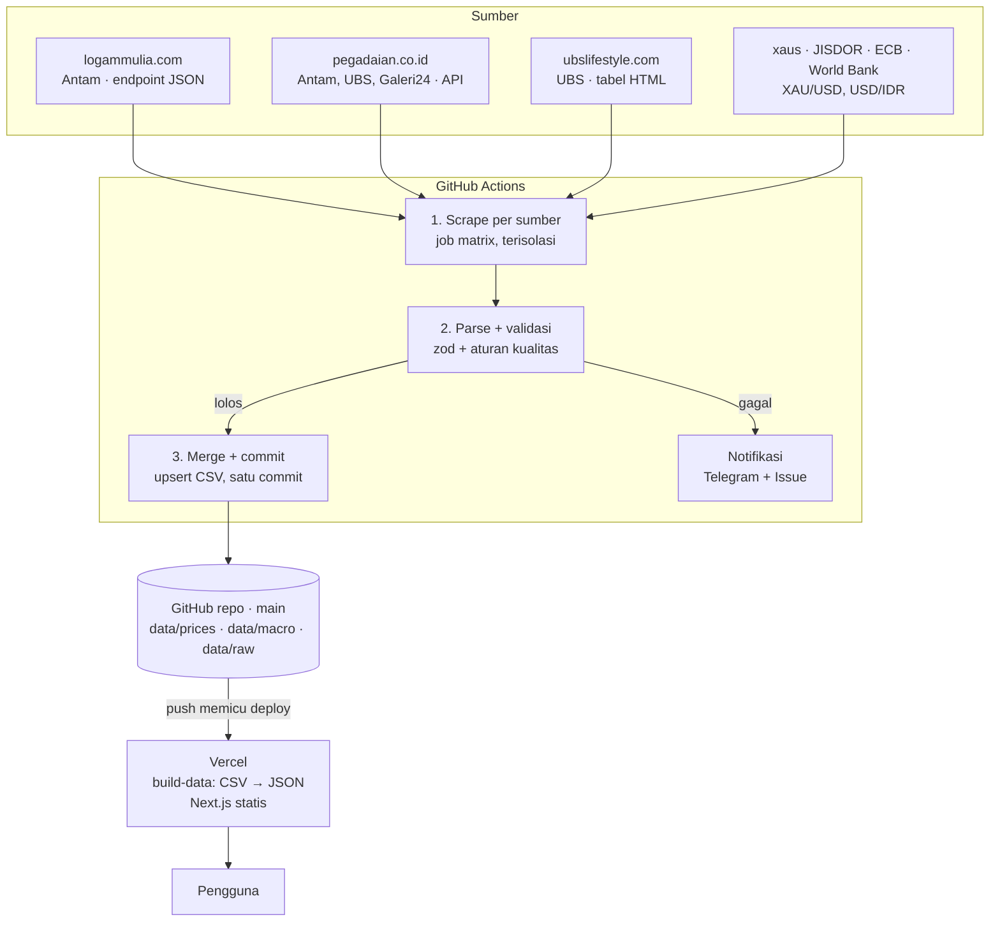

# Spesifikasi Teknis — Platform Harga Emas Historis

Pendamping [PRD.md](./PRD.md). Dokumen ini menjelaskan **bagaimana** sistem dibangun: arsitektur, struktur repo, spesifikasi tiap scraper, aturan validasi, build web, dan konvensi. Detail skema, ERD, dan aturan tulis ada di [DATA-MODEL.md](./DATA-MODEL.md); detail workflow dan deploy ada di [WORKFLOWS.md](./WORKFLOWS.md).

---

## 1. Arsitektur



Prinsip:

1. **Simpan mentah, olah belakangan.** Fragmen mentah disimpan agar data bisa di-parse ulang.
2. **Idempoten.** Upsert berdasarkan kunci unik.
3. **Gagal dengan keras.** Exit code non-nol; tidak ada penulisan data bila validasi gagal.
4. **Skema dulu.** Satu skema `zod` dipakai scraper dan web.
5. **Statis sebisa mungkin.** Komputasi turunan saat build atau di browser.

## 2. Stack

| Lapisan | Pilihan |
| --- | --- |
| Monorepo | pnpm workspaces |
| Bahasa | TypeScript (strict) dari ujung ke ujung |
| Runtime scraper | Node.js 22 + `tsx` |
| HTTP + parsing | `fetch` bawaan + `cheerio` |
| Browser headless | Playwright + `playwright-extra` + `puppeteer-extra-plugin-stealth` |
| Validasi | `zod` |
| CSV | `csv-parse` / `csv-stringify` |
| Tanggal | `date-fns` + `date-fns-tz` (zona `Asia/Jakarta` eksplisit) |
| XLSX (World Bank, ekspor JISDOR) | `xlsx` (SheetJS 0.20.3 dari CDN resmi, D-21) |
| Scheduler | GitHub Actions |
| Web | Next.js (App Router), static export / SSG |
| Grafik | Apache ECharts via `echarts-for-react` |
| UI | Tailwind CSS + shadcn/ui |
| State URL | `nuqs` |
| Uji | Vitest (+ Playwright Test untuk smoke test web) |
| Lint/format | ESLint + Prettier (atau Biome) |
| Hosting | Vercel (Hobby) |
| Notifikasi | Bot Telegram + GitHub Issues |

## 3. Struktur repository

```
gold-price-tracker/
  .github/
    actions/setup/action.yml   # node + pnpm + install
    workflows/                 # ci, probe, scrape-retail, scrape-macro, backfill, quarantine, freshness
  config/                      # ditulis manusia (PR)
    sources.yml                # sumber, kalender update, seri makro
    catalog.yml                # gramasi valid per sumber × brand × produk
    holidays.yml               # libur nasional per tahun
    events.yml                 # anotasi peristiwa untuk grafik
  data/                        # ditulis bot
    prices/{source}/{yyyy}.csv
    macro/{series}.csv
    macro/spot.json
    raw/{source}/{yyyy-mm}/{yyyy-mm-dd}T{HHMMSS}Z-{sha8}.{html|json}.gz
    quarantine/{source}/…json
    meta/status.json
    meta/runs/{yyyy}.jsonl
    meta/revisions/{yyyy}.jsonl
  packages/
    schema/                    # zod schema, enum, normalisasi, derive.ts, SCHEMA_VERSION
  apps/
    scraper/
      src/sources/             # ubslifestyle, pegadaian, logammulia, xaus, jisdor, worldbank
      src/backfill/            # worldbank, xaus, ecb, jisdor, annual-fx, ubs-history
      src/pipeline/            # plan, validate, merge, quarantine, notify, freshness
      src/cli.ts               # plan | scrape | merge | backfill | quarantine | reparse | probe | notify | freshness
      test/fixtures/{source}/
    web/
      scripts/build-data.ts    # CSV → public/data/*.json
      app/                     # /, /explorer, /spread, /bandingkan, /kalkulator, /kelipatan, /data, /kualitas
  plan/                        # dokumen perencanaan
  .gitattributes  .gitignore  .nvmrc  package.json  pnpm-workspace.yaml
```

Kontrak setiap modul sumber:

```ts
export interface SourceScraper<Row> {
  id: SourceId;                                     // 'ubslifestyle' | 'pegadaian' | 'logammulia' | 'xaus' | 'jisdor' | 'worldbank'
  kind: 'prices' | 'macro';
  parserVersion: string;                            // dicatat di RUN dan RAW_SNAPSHOT
  fetchRaw(ctx: FetchContext): Promise<RawPayload>; // { body, contentType, fetchedAt }
  parse(raw: RawPayload): ParseResult<Row>;         // fungsi murni: { rows, dataDate, sourceUpdatedAt }
}
```

Hasil scrape mengikuti kontrak artifact di [WORKFLOWS.md §2.1](./WORKFLOWS.md#21-kontrak-antar-job).

## 4. Model data

Ringkasan; definisi lengkap, ERD, kamus data, format CSV, aturan merge, dan aturan *as-of join* ada di [DATA-MODEL.md](./DATA-MODEL.md).

| Entitas | File | Kunci utama |
| --- | --- | --- |
| `PRICE_OBSERVATION` | `data/prices/{source}/{yyyy}.csv` | `date, source, brand, product, variant, weight_g, location` |
| `MACRO_OBSERVATION` | `data/macro/{series}.csv` | `date, series, frequency` |
| `SPOT_SNAPSHOT` | `data/macro/spot.json` | — (satu snapshot, ditimpa) |
| `RUN` | `data/meta/runs/{yyyy}.jsonl` | `run_id, source` |
| `SOURCE_STATUS` | `data/meta/status.json` | `source_id` |
| `REVISION` | `data/meta/revisions/{yyyy}.jsonl` | — (log tambah-saja) |
| `QUARANTINE_BATCH` | `data/quarantine/{source}/{date}-{run_id}.json` | path |
| `RAW_SNAPSHOT` | `data/raw/{source}/{yyyy-mm}/…gz` | path (berisi sha256) |
| `SOURCE`, `MACRO_SERIES` | `config/sources.yml` | `id` |
| `CATALOG_ITEM` | `config/catalog.yml` | `source, brand, product, weight_g` |
| `HOLIDAY`, `EVENT` | `config/holidays.yml`, `config/events.yml` | `date` |

Tiga aturan yang paling menentukan perilaku pipeline:

1. **Upsert berbasis nilai.** Baris yang nilainya tidak berubah tidak disentuh sama sekali (termasuk `scraped_at`), sehingga run berulang tidak menghasilkan diff. Nilai yang berubah ditulis dan dicatat di `REVISION`.
2. **Ketiadaan ≠ penghapusan.** Scraper tidak pernah menghapus baris.
3. **Atomik per sumber, karantina per baris.** Pelanggaran tingkat run menggagalkan seluruh sumber; pelanggaran tingkat baris hanya menahan baris itu.

## 5. Spesifikasi scraper per sumber

### 5.1 UBS Lifestyle (`ubslifestyle.ts`)

Hasil riset P0-07 (25 Okt 2026, fixture di `apps/scraper/test/fixtures/ubslifestyle/`):

- **Akses:** `GET https://ubslifestyle.com/harga-buyback-hari-ini/` → 200, HTML WordPress di belakang Cloudflare tanpa tantangan JS; `curl` biasa dengan User-Agent proyek cukup (`fetch_method: http`). Halaman di-cache server (`x-fastcgi-cache: HIT`).
- **Struktur tabel:** di dalam `div.table-product-wrapper` ada `table[data-hide="beli"]`. Baris header `<th colspan="2">Tahun 2026</th>` → `variant`; baris kedua berlabel `Pecahan | Harga Beli | Harga Jual (Buyback)`; lalu satu `<tr>` per pecahan: sel 1 `0.05 Gram` (label dibungkus `div`), sel 2 "Harga Beli" → `sell_price`, sel 3 "Harga Jual (Buyback)" → `buyback_price`. Per 25 Okt 2026 hanya **satu** tabel tahun produksi (2026) yang tampil; parser tetap mengiterasi setiap tabel/blok berlabel "Tahun YYYY" (D-08). CSS `data-hide="beli"` menyembunyikan kolom Harga Beli di layar, tetapi nilainya ada di HTML.
- **Pecahan:** 13 — 0,05 · 0,1 · 0,25 · 0,5 · 1 · 2 · 3 · 4 · 5 · 10 · 25 · 50 · 100 g (= `config/catalog.yml`). Label memakai titik desimal (`0.05 Gram`).
- **Blok "Updated" tidak bisa dipakai sebagai waktu update harga:** tanggal (`25 October 2026`) dicetak server saat halaman di-cache, dan jam (`#clock`) ditimpa JavaScript `updateClock()` dengan jam peramban. Pada fixture hari Minggu, tanggal halaman = hari ini padahal harga = data Sabtu. Karena itu `source_updated_at` = `null` dan aturan V-06 tidak bisa memakai tanggal halaman (D-19).
- **Endpoint grafik (jawaban Q-2):** `POST /wp-admin/admin-ajax.php`, body `action=get_harga_emas_hari_ini&path=ajax/chart_interval/GOLD/{hari}`, header `X-Requested-With: XMLHttpRequest`. Respons `[{"name":"GOLD","data":[[ts_ms, a, a, a, b], …],"source":"local"}]`, `ts` = 00:00 UTC tanggal harga (ambil `YYYY-MM-DD` dari UTC, jangan dikonversi). `a` = **buyback 1 g** (cocok dengan tabel); `b` selalu 4.000–15.000 lebih rendah, artinya belum diketahui. Varian `chart_interval_jual` mengembalikan data yang identik (tombol Harga Beli/Jual di halaman tidak mengubah seri); `chart_range/...` selalu `data: []`. Histori terpanjang = 543 titik, **20 Nov 2023 → kini**, berapa pun `{hari}`, dengan celah (terpanjang 79 hari, Jun–Sep 2025).
- **Kalender update (bahan Q-6):** dari histori grafik, data ada Senin–Sabtu (Sabtu ada setiap minggu dalam 8 minggu terakhir), hampir tidak pernah Minggu; sebagian libur nasional tetap update (mis. 17 Agu, 1 Mei), sebagian tidak (1 Jan, Imlek, Nyepi, Idulfitri, Iduladha).
- **Tanggal data & stale (D-19):** scraper memanggil `chart_interval/GOLD/7` setelah halaman (jeda 5 detik). `data_date` = tanggal titik terakhir grafik bila nilai `a`-nya sama dengan buyback 1 g tabel tahun berjalan; bila tidak sama, run berstatus `stale` (situs sedang di tengah pembaruan atau cache belum segar). `stale` dianggap kegagalan hanya pada hari yang diharapkan menurut `update_calendar`; tanggal data < tanggal berjalan pada hari yang diharapkan juga `stale`.
- **Normalisasi:** `Rp1.403.300` → `1403300`; `0.05 Gram` / `0,5 Gram` → `0.05` / `0.5`. Sel tanpa angka (mis. `-`) → `null`.
- **Validasi khusus:** ≥ 13 pecahan untuk tahun berjalan (V-04).
- **Backfill (FR-08, P1-09):** layak hanya untuk **buyback 1 g** sejak Nov 2023 (`sell_price` kosong, `variant` tidak diketahui → `''`, `origin = backfill`). Tahun produksi seri grafik tidak tercantum; putuskan di P1-09 apakah tetap diambil.

### 5.2 Pegadaian (`pegadaian.ts`)

Hasil riset P0-08 (25 Okt 2026, fixture di `apps/scraper/test/fixtures/pegadaian/`):

- **Halaman:** Nuxt 3; harga **tidak** ada di HTML SSR, melainkan dimuat klien dari endpoint same-origin (proksi ke `agata.pegadaian.co.id`). Halaman memuat skrip Cloudflare *challenge-platform* (JSD) di latar, tetapi endpoint JSON tidak memerlukannya.
- **Endpoint utama:** `GET https://pegadaian.co.id/gold/prices/table` → `application/json`, ±19 KB. `curl`/`fetch` biasa dengan User-Agent proyek cukup; **tidak** ada token, cookie, atau header wajib (`fetch_method: api`).
- **Bentuk respons:** `{ responseCode: "2000000100", responseDesc: "Approved", data: VendorPrices[] }`. Setiap `VendorPrices`: `idHarga` (epoch ms, waktu entri harga dibuat), `tglBerlaku` (`YYYY-MM-DD`, tanggal harga berlaku), `keterangan` (mis. `"JUAL EB 241026 PER II"`), `idVendor` (kode 14 digit), `namaVendor`, `hargaMuliaDetails: [{ idHargaDetail, berat, hargaJual, hargaBeli }]`, `timestamp` (epoch ms, sama untuk semua vendor — waktu cache/ekspor, bukan update harga).
- **Vendor:** 10 vendor, termasuk varian yang tidak ditampilkan di tabel halaman (ANTAM MULIA RETRO, LOTUS ARCHI, UBS DISNEY/ANNA/ELSA/MICKEY FULLBODY, BATIK SERIES). Parser memetakan lewat `idVendor` (D-20): `00005201808001` → `antam`, `00005201808002` → `ubs`, `00005202003010` → `galeri24`; vendor lain diabaikan (tidak dikarantina), dicatat jumlahnya di `RUN`. `GET /gold/prices/vendors?isRequest=true` mengembalikan tiga vendor yang ditampilkan halaman — dipakai sebagai cek silang, bukan sumber utama.
- **Gramasi:** `hargaMuliaDetails` memuat semua 25 gramasi templat; `hargaJual = 0` berarti tidak dijual dan dibuang. Gramasi berharga per 24 Okt 2026: Galeri 24 0,5–1.000 g (11), ANTAM 0,5–100 g termasuk 3 g (9), UBS 0,5–500 g (10) — sama dengan `config/catalog.yml`.
- **Buyback (jawaban awal Q-1):** **tidak tersedia** untuk emas batangan; `hargaBeli` selalu `null`, dan halaman hanya menampilkan satu kolom harga per brand. `buyback_price` Pegadaian selalu kosong (D-07). Buyback hanya ada untuk **Tabungan Emas** (`GET /gold/prices`, per 0,01 g; grafik 360 hari di `GET /gold/prices/chart`) — di luar cakupan v1, dicatat sebagai kandidat backlog.
- **Pemetaan kolom:** `tglBerlaku` → `date` dan `data_date`; `hargaJual` → `sell_price`; `berat` → `weight_g` (lewat `canonicalWeight`); `idHarga` → `source_updated_at` (`jakartaIso`); `variant = ''`, `location = ''`, `product = gold_bar`.
- **Tanggal & stale:** pada fixture hari Minggu, `tglBerlaku` = Sabtu (harga emas batangan tidak diperbarui Minggu), sedangkan Tabungan Emas `tglBerlaku` = Minggu. `stale` bila `tglBerlaku` < tanggal Jakarta hari ini; kegagalan hanya pada hari yang diharapkan (Q-6). Bila tiga vendor target punya `tglBerlaku` berbeda, run `failed` (`VALIDATION_FAILED`).
- **Pembaruan dalam sehari:** `keterangan` memuat `PER II` dan `idHarga` 24 Okt bertanggal ±10.18–10.35 WIB; harga tampaknya bisa ditetapkan lebih dari sekali per hari ("periode"). Run `retry` 13.25 WIB akan meng-update baris yang sama bila harga berubah (DATA-MODEL §5, revisi tercatat). Pola periode dikonfirmasi saat observasi P1-11.
- **Risiko jadwal (untuk P1-08/P1-11):** PRD semula memperkirakan update ±07.30 WIB, tetapi `idHarga` menunjukkan harga 24 Okt dibuat 10.18–10.35 WIB — **tepat di sekitar slot primary 10.25 WIB** (cron GitHub juga sering terlambat 5–30 menit). Akibatnya slot primary bisa membaca campuran periode lama/baru antar vendor (ditangkap aturan "tglBerlaku sama") atau harga periode I yang lalu direvisi di slot retry. Bila pola ini konsisten selama observasi, geser slot primary ke ±11.05 WIB atau andalkan slot retry untuk Pegadaian.
- **Harga Minggu & periode (P1-07, 26 Okt 2026):** respons Senin 09.43 WIB berisi `tglBerlaku` = Minggu 25 Okt, `keterangan` `JUAL EB 251026 PER I`, `idHarga` **Sabtu 18.08–18.31 WIB**, nilai sama dengan Sabtu. Jadi harga hari berikutnya (periode I) diterbitkan malam sebelumnya, termasuk untuk hari Minggu; temuan P0-08 "tidak diperbarui Minggu" hanya karena fixture diambil 08.50 WIB. Harga Senin belum ada pukul 09.43 (Minggu malam tidak menerbitkan periode I untuk Senin). `update_calendar` tetap `daily`; pola final di P1-11. Fixture: `prices-table-2026-10-26-monday-per-i.json`.
- **Fallback:** Playwright membaca tabel DOM ("Harga Emas Batangan") tetap disiapkan bila endpoint berubah/diblokir, tetapi bukan jalur utama.
- **Validasi khusus:** setiap brand target punya ≥ 5 gramasi berharga (V-04); `responseCode = 2000000100`.

### 5.3 Logam Mulia / Antam (`logammulia.ts`)

> **Status riset P0-09 (25 Okt 2026): tertahan.** Prototipe `apps/scraper/scripts/prototype-logammulia.ts` (Playwright 1.64 + `playwright-extra` + stealth) berjalan, tetapi seluruh domain `logammulia.com` mengembalikan **HTTP 503** dari Akamai dengan halaman "Maintenance": *layanan operasional tutup sementara karena sedang mempersiapkan aplikasi versi terbaru*. Hasilnya sama lewat `curl` biasa dan untuk semua path (`/id`, `/robots.txt`, `/data-base-price/*`), jadi ini bukan blokir bot. Langkah di bawah **belum terverifikasi** dan bisa berubah total bila versi baru mengganti endpoint atau mekanisme token. Fixture maintenance disimpan; saat situs kembali, jalankan ulang prototipe (1–2 kali), simpan fixture jual & buyback, lalu perbarui bagian ini.
>
> Klasifikasi untuk P1-06: HTTP 503 + `<title>Maintenance</title>` → `failed` dengan `error_code = FETCH_HTTP` dan pesan `MAINTENANCE` (bukan `BLOCKED`), agar Issue membedakan situs tutup dari pemblokiran.

1. Chromium headless via `playwright-extra` + plugin stealth.
2. `goto('https://www.logammulia.com/id', { waitUntil: 'networkidle', timeout: 60_000 })`.
3. Token: `page.inputValue('input[name="_token"]')`.
4. Dari dalam konteks halaman (`page.evaluate` + `fetch`), header `Accept: application/json`, `X-Requested-With: XMLHttpRequest`, jeda 5 detik antar panggilan:
   - jual: `/data-base-price/gold_eai/sell?_token=<token>&transition=1`
   - buyback: `/data-base-price/gold/buy?_token=<token>`
5. Respons: `[timestamp_ms, harga][]` untuk 1 g (jual sejak Jan 2010 ±5.150 titik; buyback sejak Nov 2015 ±3.600 titik, per 23 Okt 2026).
6. Normalisasi: timestamp → tanggal `Asia/Jakarta`; titik terakhir per hari = penutupan; `brand=antam`, `product=gold_bar`, `weight_g=1`, `location=jakarta`. Jual dan buyback digabung per tanggal menjadi satu baris; tanggal sebelum Nov 2015 hanya berisi `sell_price`. `source_updated_at` = timestamp terbaru dari kedua titik terpilih.
7. Kedua endpoint harus sukses; bila salah satu gagal, seluruh run gagal (atomik).
8. Merge menulis hanya tanggal baru/berubah (DATA-MODEL §5). Raw mentah disimpan hanya bila sha256 berbeda dari snapshot terakhir. Revisi > 20 baris histori dalam satu run → karantina `MASS_REVISION`.

```ts
import { chromium } from 'playwright-extra';
import stealth from 'puppeteer-extra-plugin-stealth';

chromium.use(stealth());
const browser = await chromium.launch({ headless: true });
const page = await browser.newPage();
await page.goto('https://www.logammulia.com/id', { waitUntil: 'networkidle', timeout: 60_000 });
const token = await page.inputValue('input[name="_token"]');

const getSeries = (url: string) =>
  page.evaluate(async (u) => {
    const res = await fetch(u, { headers: { Accept: 'application/json', 'X-Requested-With': 'XMLHttpRequest' } });
    if (!res.ok) throw new Error(`HTTP ${res.status}`);
    return (await res.json()) as [number, number][];
  }, url);

const sell = await getSeries(`/data-base-price/gold_eai/sell?_token=${token}&transition=1`);
await page.waitForTimeout(5_000);
const buyback = await getSeries(`/data-base-price/gold/buy?_token=${token}`);
await browser.close();
```

**Aturan wajib:** exit non-nol bila token tidak ada / HTTP ≠ 200 / respons bukan array JSON; titik terakhir ≤ 3 hari; jumlah titik histori tidak menyusut dibanding run sebelumnya; tidak ada sumber pengganti bila gagal.

### 5.4 XAU/USD (`xaus.ts`)

- Harian: `GET https://xaus.com/api/v1/history` → ambil penutupan **10 hari terakhir** dan upsert semuanya (menutup akhir pekan, libur, dan run yang terlewat; baris yang sama tidak disentuh). Penutupan hari berjalan tidak diambil karena belum final.
- Spot: `GET https://xaus.com/api/v1/spot?compact=1` → ditimpa ke `data/macro/spot.json` (tidak masuk CSV), dipakai sebagai titik bergaris putus.
- Tolak respons basi (V-10): histori bila `data_state.status ≠ "fresh"`, spot bila `stale: true`.

Hasil riset P0-10 (25 Okt 2026, fixture di `apps/scraper/test/fixtures/xaus/`):

- **Akses:** JSON publik tanpa API key; `curl` biasa cukup. Respons di-cache CDN (`Cache-Control: max-age=1800, s-maxage=21600`).
- **`/history`:** `{ symbol: "XAUUSD", interval: "daily", unit: "troy_oz", points: [{ d, c, h, l }], count, updated_at, data_state: { status, as_of, age_seconds }, price_source }`. `d` = tanggal perdagangan, `c` = penutupan. 1.258 titik, 2021-10-25 → 2026-10-23 (± 5 tahun), hanya hari perdagangan. **`price_source` = `"yahoo finance (GC=F)"`**, yaitu kontrak berjangka emas COMEX, bukan spot LBMA; selisihnya biasanya < 1% tetapi harus disebut di UI dan `config/sources.yml`.
- **Stale:** `/history` tidak punya field `stale` di akar; pakai `data_state.status` (`"fresh"`) untuk V-10. `/spot` punya `stale` (boolean) dan `fx_stale`.
- **`/spot?compact=1`:** `spot_usd_oz` (presisi 6 desimal), `price_as_of`, `price_source: "gold-api.com"` — **sumber berbeda** dari histori. Bidang lain (BTC, cadangan bank sentral, dsb.) diabaikan.
- **Tanggal:** fixture hari Minggu: titik terakhir `/history` = Jumat 23 Okt; spot tetap ada (harga terakhir pasar).

### 5.5 USD/IDR JISDOR (`jisdor.ts`)

- Sumber: halaman histori JISDOR di bi.go.id (terbit 15.15 WIB hari kerja).
- Setiap run mengambil **10 hari terakhir** dan meng-upsert semuanya.
- Fallback harian bila BI tidak dapat diakses: Frankfurter `usd_idr_ecb` (disimpan sebagai seri terpisah, bukan menimpa JISDOR).

Hasil riset P0-10 (25 Okt 2026, fixture di `apps/scraper/test/fixtures/jisdor/`):

- **Halaman:** `https://www.bi.go.id/id/statistik/informasi-kurs/jisdor/default.aspx`, SharePoint / ASP.NET WebForms (±640 KB, `__VIEWSTATE` ±230 KB). Tidak ada tantangan bot; `fetch` biasa + User-Agent cukup. Server memasang cookie sesi (`cookie_BIWEB`, `TS…`).
- **Harian (D-21):** `GET` halaman saja sudah berisi tabel `table.table-striped` dengan **10 hari kerja terakhir** (`Tanggal | Kurs`, mis. `23 Oktober 2026 | Rp 18.069,00`), persis kebutuhan "10 hari terakhir" — satu request, tanpa postback. Tanggal berformat `D NamaBulan YYYY` (bulan Indonesia) → perlu peta nama bulan; kurs dibaca dengan `parseRupiah` (akhiran `,00`; nilai sen non-nol akan gagal keras).
- **Backfill (D-21):** postback form: `GET` halaman (ambil semua `input[type=hidden]` + cookie), lalu `POST` ke URL yang sama dengan `__EVENTTARGET = …$ButtonExport`, `…$TextBoxFrom` / `…$TextBoxDateTo` / `…$HiddenFieldDateFrom` / `…$HiddenFieldDateTo` = `dd/mm/yyyy`. Respons `xlsx` (`Informasi Kurs Jisdor.xlsx`), satu sheet: judul, baris kosong, header `NO | Tanggal | Kurs`, lalu data. Satu postback 20/05/2013–24/10/2026 = **3.251 baris** (78 KB). Sel berupa **teks**: tanggal `M/D/YYYY 12:00:00 AM` (format AS), kurs `9.760,00` (format Indonesia).
- **Nama field** memuat ID web part SharePoint (`ctl00$ctl51$g_8e393016_…$ctl00$`); parser mencari field berdasarkan akhiran (`$TextBoxFrom`, `$ButtonExport`) agar tahan bila ID berubah.
- **Cek silang:** 23 Okt 2026 JISDOR 18.069 vs ECB 18.107,80 (selisih 0,2%, wajar karena jam penetapan berbeda).

### 5.6 Backfill makro (sekali jalan)

| Skrip | Sumber | Seri | Rentang |
| --- | --- | --- | --- |
| `backfill/worldbank.ts` | Pink Sheet XLSX (monthly) | `xau_usd_oz` frekuensi `M` | 1996 → bulan lalu |
| `backfill/xaus.ts` | `/api/v1/history` | `xau_usd_oz` frekuensi `D` | 5 tahun terakhir |
| `backfill/ecb.ts` | Frankfurter `v2/rates.csv` | `usd_idr_ecb` = EUR/IDR ÷ EUR/USD | **4 Jan 1999** → kini |
| `backfill/jisdor.ts` | Ekspor XLSX JISDOR (§5.5) | `usd_idr_jisdor` | 20 Mei 2013 → kini |
| `backfill/annual-fx.ts` | File statis terverifikasi | `usd_idr_annual` | 1996–1998 |

Hasil riset P0-10 (25 Okt 2026, fixture di `apps/scraper/test/fixtures/{frankfurter,worldbank}/`):

- **Frankfurter:** `GET https://api.frankfurter.dev/v2/rates.csv?base=EUR&quotes=IDR,USD&from=1999-01-01&to=<hari ini>&providers=ecb` → `text/csv` long format `date,base,quote,rate`; satu request = seluruh histori (14.242 baris, 7.121 tanggal kerja ECB, 1999-01-04 → kini, ±380 KB, tidak ada tanggal yang kehilangan IDR atau USD). Tanpa API key. URL tanpa `/v2` mengembalikan 404; API v1 (`/v1/1999-01-01..?base=EUR&symbols=IDR,USD`, JSON) setara dan menjadi cadangan. Fallback harian JISDOR memakai URL yang sama dengan `from` = 10 hari lalu.
- **World Bank Pink Sheet:** halaman https://www.worldbank.org/en/research/commodity-markets menautkan `https://thedocs.worldbank.org/en/doc/<hash>-<kode-rilis>/related/CMO-Historical-Data-Monthly.xlsx`; **hash berubah setiap rilis**, jadi scraper membaca halaman lalu mengambil tautan berakhiran `CMO-Historical-Data-Monthly.xlsx`. File ±590 KB, sheet `Monthly Prices`: baris judul ("Updated on October 02, 2026"), baris nama komoditas (kolom `Gold`, saat ini indeks 69 dari 89), baris satuan (`($/troy oz)`), lalu data dengan label periode `YYYYMmm` (1960M01 → bulan lalu). Nilai emas berupa **bilangan bulat** (dibulatkan World Bank). Parse berdasarkan nama kolom `Gold`, bukan posisi. Rilis bulanan ±tanggal 2 memuat bulan sebelumnya, sesuai aturan `plan` (tanggal ≥ 5).
- **Pustaka XLSX:** SheetJS dipasang dari CDN resmi (`https://cdn.sheetjs.com/xlsx-0.20.3/xlsx-0.20.3.tgz`) karena paket `xlsx` di registri npm berhenti di 0.18.5 yang memiliki kerentanan yang sudah diketahui (D-21).

## 6. Pipeline

Ringkasan; YAML lengkap, kontrak antar job, logika slot, notifikasi, matriks kegagalan, kredensial, dan pengaturan Vercel ada di [WORKFLOWS.md](./WORKFLOWS.md).

| Workflow | Jadwal (WIB) | Isi |
| --- | --- | --- |
| `scrape-retail.yml` | 10.25 (primary), 13.25 (retry) | UBS Lifestyle, Pegadaian, Logam Mulia |
| `scrape-macro.yml` | 16.40 hari kerja | xaus, JISDOR (+ World Bank bulanan) |
| `freshness.yml` | 19.15 | Deteksi sumber/workflow berhenti |
| `backfill.yml`, `quarantine.yml`, `probe.yml` | Manual | Histori, tinjauan karantina, uji sumber |
| `ci.yml` | PR / push kode | Lint, typecheck, test, build |

Alur setiap workflow penulis data: `plan → scrape (matrix per sumber) → merge + commit → notify`, dengan `concurrency: data-write` agar hanya ada satu penulis.

## 7. Aturan validasi (gerbang kualitas)

Tingkat **run** = seluruh hasil sumber itu tidak ditulis (`failed`). Tingkat **baris** = baris itu masuk karantina, sisanya ditulis (`partial`). Lihat DATA-MODEL §5.

| Kode | Aturan | Berlaku untuk | Tingkat | Bila gagal |
| --- | --- | --- | --- | --- |
| V-01 | Lolos skema `zod` (tipe, kolom wajib, enum, minimal satu harga terisi) | Semua | Run | `SCHEMA_INVALID` |
| V-02 | `source × brand × product × weight_g` ada di `config/catalog.yml` dan aktif | Harga ritel | Baris | Karantina `UNKNOWN_ITEM` → tambahkan ke katalog lalu setujui |
| V-03 | `buyback_price < sell_price` pada baris yang sama | Harga ritel | Run | `VALIDATION_FAILED` |
| V-04 | Jumlah baris ≥ minimum (UBS ≥ 13 untuk tahun berjalan; Pegadaian ≥ 5 per brand) | Harga ritel | Run | `VALIDATION_FAILED` |
| V-05 | Harga per gram berubah ≤ ±10% dari nilai terakhir seri yang sama | Harga ritel | Baris | Karantina `PRICE_JUMP` |
| V-06 | Tanggal data = hari ini. UBS: titik terakhir grafik yang cocok dengan buyback 1 g tabel (D-19); Pegadaian: `tglBerlaku` (D-20) | UBS, Pegadaian | Run | `stale`; gagal hanya pada hari yang diharapkan |
| V-07 | Titik terakhir ≤ 3 hari; jumlah titik histori ≥ `status.history_points` | Logam Mulia | Run | `VALIDATION_FAILED` |
| V-08 | Kurs berubah ≤ ±5% per hari | USD/IDR | Baris | Karantina `PRICE_JUMP` |
| V-09 | Emas berubah ≤ ±8% per hari | XAU/USD | Baris | Karantina `PRICE_JUMP` |
| V-10 | Respons tidak basi: histori `data_state.status = "fresh"`, spot `stale = false` | xaus | Run | `STALE_SOURCE` |
| V-11 | Revisi nilai histori (tanggal < kemarin) ≤ 20 baris per run | Semua | Run | Karantina seluruh batch `MASS_REVISION` |

## 8. Build web

`apps/web/scripts/build-data.ts` dijalankan sebelum `next build`:

| Output | Isi |
| --- | --- |
| `public/data/latest.json` | Harga terbaru per series + perubahan vs hari sebelumnya + isi `spot.json` |
| `public/data/series/{source}-{brand}.json` | Seri harian per sumber × brand, kolom ringkas |
| `public/data/macro/{series}.json` | Seri makro mentah per frekuensi |
| `public/data/derived/gold-idr-gram.json` | Rp/gram spot harian + seri kurs yang dipakai per titik |
| `public/data/derived/annual.json` | Rata-rata tahunan emas US$, kurs, Rp/gram + resolusi yang dipakai (DATA-MODEL §6.3) |
| `public/data/derived/premium-antam.json` | Premi Antam vs spot harian (*as-of join*) |
| `public/data/quality.json` | Kelengkapan per sumber per bulan, 90 run terakhir, karantina terbuka |
| `public/data/meta.json` | `SCHEMA_VERSION`, katalog series, status sumber, umur data, events, waktu build |
| `public/data/csv/*.csv` | Salinan CSV untuk unduhan |

Format seri ringkas untuk menekan ukuran: `{ "fields": ["date","variant","w","sell","buyback"], "rows": [["2026-10-24","2026",1,2488800,2291000], …] }`. Satu series di UI = filter `variant + w` atas file ini.

## 9. Pengujian

| Lapisan | Alat | Cakupan |
| --- | --- | --- |
| Parser | Vitest + fixture HTML/JSON asli | Setiap sumber ≥ 2 fixture (normal + kasus tepi) |
| Validasi | Vitest | Setiap aturan V-xx punya uji lolos dan gagal |
| Merge/upsert | Vitest | Insert / unchanged / update+revisi, ketiadaan ≠ hapus, urutan stabil, raw dedupe sha256, merge 2× = tanpa diff |
| Plan & notifikasi | Vitest | Pemilihan sumber per slot, kalender + libur, de-duplikasi Issue |
| Karantina | Vitest | Approve/reject, pemindahan ke `_resolved`, revisi tercatat |
| Turunan | Vitest | Rumus spread, Rp/gram, indeks, CAGR, premi, *as-of join* + toleransi, resolusi frekuensi tahunan |
| Web | Playwright Test | Smoke: setiap halaman render, filter URL bekerja |
| Kontrak live | Workflow `probe` manual | Fetch nyata tanpa menulis data |

## 10. Konvensi

- Commit data: `data: YYYY-MM-DD <source>✓|✗ …`; commit kode: Conventional Commits.
- Branch: ruleset `main` memblokir force-push dan penghapusan; bot push data dengan `GITHUB_TOKEN`; kode lewat PR dengan CI hijau (WORKFLOWS §6.1, D-17).
- CLI:
  ```bash
  pnpm --filter scraper start plan --workflow scrape-retail --event workflow_dispatch --root "$PWD"
  pnpm --filter scraper start scrape --source ubslifestyle --root "$PWD" --out "$PWD/out/ubslifestyle"
  pnpm --filter scraper start merge --in "$PWD/out" --root "$PWD" --summary "$PWD/summary/summary.json"
  pnpm --filter scraper start backfill --job worldbank --root "$PWD" --out "$PWD/out/backfill"
  pnpm --filter scraper start quarantine --path data/quarantine/pegadaian/2026-11-03-123-1.json --decision approve
  pnpm --filter scraper start reparse --source ubslifestyle --from 2026-11-01 --root "$PWD"
  pnpm --filter scraper start probe --source logammulia --root "$PWD"   # fetch tanpa menulis
  pnpm --filter scraper start freshness --root "$PWD"
  pnpm --filter scraper start check --root "$PWD"       # validasi config/ + status.json
  ```
- Uang disimpan sebagai integer rupiah; tidak ada float untuk harga ritel.
- Semua tanggal harga `Asia/Jakarta`; timestamp teknis UTC.
