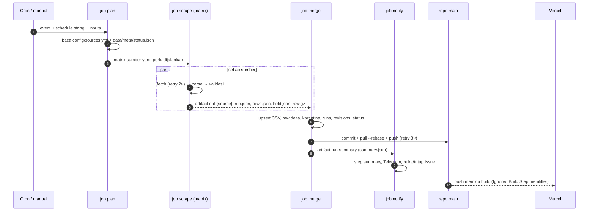

# Workflow GitHub Actions & Deploy

Spesifikasi rinci setiap workflow, kontrak antar job, perilaku saat gagal, dan konfigurasi Vercel. Skema data yang ditulis workflow ada di [DATA-MODEL.md](./DATA-MODEL.md).

---

## 1. Daftar workflow

| File | Pemicu | Tujuan | Menulis data? | Fase |
| --- | --- | --- | --- | --- |
| `ci.yml` | PR, push ke `main` (kecuali `data/**`) | Lint, typecheck, test, build web | Tidak | 0 |
| `probe.yml` | Manual | Fetch + parse + validasi satu sumber tanpa menulis | Tidak | 0 |
| `scrape-retail.yml` | Cron 10.25 & 13.25 WIB (jendela siang), 19.05 & 21.05 WIB (jendela malam), manual | Harga ritel | Ya | 1 |
| `quarantine.yml` | Manual | Setujui/tolak baris yang ditahan | Ya | 1 |
| `backfill.yml` | Manual | Isi histori sekali jalan | Ya | 1–2 |
| `scrape-macro.yml` | Cron 16.40 WIB hari kerja, manual | XAU/USD, USD/IDR, refresh bulanan World Bank | Ya | 2 |
| `freshness.yml` | Cron 22.15 WIB harian | Deteksi sumber/workflow yang berhenti | Tidak (hanya Issue) | 5 |

Semua workflow yang menulis data memakai `concurrency: { group: data-write, cancel-in-progress: false }` di tingkat workflow, sehingga tidak pernah ada dua penulis bersamaan.

> **Catatan concurrency:** GitHub hanya menyimpan **satu** run *pending* per grup. Jika tiga run menumpuk (mis. dua dispatch manual saat run terjadwal berjalan), run pending yang lebih lama dibatalkan. Jadwal ritel dan makro terpaut lebih dari 2 jam, jadi ini hanya relevan untuk run manual.

## 2. Alur `scrape-retail`



### 2.1 Kontrak antar job

| Dari → ke | Isi | Lokasi |
| --- | --- | --- |
| `plan` → `scrape` | `matrix` = `{"include":[{"source":"ubslifestyle","browser":false}, …]}`, `slot` = `primary`/`retry`/`manual`, `date` (tanggal sasaran, D-27), `has_work`, `sources` (CSV) | `outputs` job |
| `scrape` → `merge` | `run.json` (baris `RUN` tanpa hitungan insert/update), `rows.json` (baris lolos validasi run-level), `held.json` (baris untuk karantina), `raw.{html,json}.gz` | artifact `out-{source}` |
| `merge` → `notify` | `summary.json`: hasil per sumber (status, error_code, hitungan, path karantina), `commit_sha`, `merge_ok` | artifact `run-summary` |

Bila artifact `out-{source}` tidak ada (job scrape mati sebelum upload), `merge` mencatat sumber itu sebagai `failed` dengan `error_code = UNKNOWN` berdasarkan daftar `sources` dari `plan`.

### 2.2 Logika `plan`

| Pemicu | Sumber yang dijalankan |
| --- | --- |
| Cron `25 3 * * *` (slot `primary`, jendela `day`) | Semua sumber `enabled` dengan `workflow: scrape-retail` dan `schedule_window: day` |
| Cron `25 6 * * *` (slot `retry`, jendela `day`) | Sumber jendela `day` yang hari ini belum `success`/`partial` atau masih `stale` pada hari yang diharapkan |
| Cron `5 12 * * *` (slot `primary`, jendela `evening`) | Seperti primary, untuk sumber `schedule_window: evening` (Pegadaian, D-25) |
| Cron `5 14 * * *` (slot `retry`, jendela `evening`) | Seperti retry, untuk sumber jendela `evening` |
| Manual | Input `sources` (kosong = semua, kecuali sumber `evening` sebelum 18.45 WIB); `force: false` melewati sumber yang hari ini sudah sukses |

Pemetaan cron → slot + jendela ada di `SCHEDULES` (`apps/scraper/src/pipeline/plan.ts`); tes memastikan isinya sama dengan `on.schedule` di YAML.

**Tanggal sasaran (D-27):** "hari ini" pada tabel di atas, aturan V-06, dan pesan commit memakai output `date`: untuk run terjadwal = tanggal Jakarta dari kemunculan cron terakhir ≤ waktu run, untuk run manual = tanggal sekarang. `plan` meneruskannya ke `scrape --date` dan `merge --date`; CLI hanya menerima hari ini atau kemarin (WIB). "Sudah sukses" diukur dengan `last_data_date` = tanggal sasaran.

Jika daftar kosong, `has_work=false` dan semua job lain dilewati (workflow tetap hijau).

### 2.3 Kode keluar scraper

| Kode | Arti | Warna job |
| --- | --- | --- |
| 0 | `success`, `partial`, atau `stale` pada hari yang **tidak** diharapkan | Hijau |
| 1 | `failed` (fetch, blokir, parse, skema, validasi run-level) | Merah |
| 3 | `stale` pada hari yang diharapkan | Merah (akan dicoba lagi di slot `retry`) |

`run.json` selalu ditulis sebelum keluar, apa pun kodenya.

## 3. YAML

### 3.1 Aksi komposit `.github/actions/setup/action.yml`

```yaml
name: setup
description: Node + pnpm + dependensi
runs:
  using: composite
  steps:
    - uses: pnpm/action-setup@v4          # versi dari field "packageManager" di package.json
    - uses: actions/setup-node@v4
      with:
        node-version-file: .nvmrc
        cache: pnpm
    - run: pnpm install --frozen-lockfile
      shell: bash
```

### 3.2 `scrape-retail.yml`

```yaml
name: scrape-retail

on:
  schedule:
    - cron: '25 3 * * *'   # 10.25 WIB — slot primary, jendela day
    - cron: '25 6 * * *'   # 13.25 WIB — slot retry, jendela day
    - cron: '5 12 * * *'   # 19.05 WIB — slot primary, jendela evening (Pegadaian)
    - cron: '5 14 * * *'   # 21.05 WIB — slot retry, jendela evening
  workflow_dispatch:
    inputs:
      sources:
        description: Sumber dipisah koma (kosong = semua yang aktif)
        required: false
        default: ''
      force:
        description: Jalankan walau hari ini sudah sukses
        type: boolean
        default: false

permissions:
  contents: write
  issues: write

concurrency:
  group: data-write
  cancel-in-progress: false

jobs:
  plan:
    runs-on: ubuntu-latest
    timeout-minutes: 5
    outputs:
      matrix: ${{ steps.plan.outputs.matrix }}
      sources: ${{ steps.plan.outputs.sources }}
      slot: ${{ steps.plan.outputs.slot }}
      date: ${{ steps.plan.outputs.date }}
      has_work: ${{ steps.plan.outputs.has_work }}
    steps:
      - uses: actions/checkout@v4
      - uses: ./.github/actions/setup
      - id: plan
        run: >
          pnpm --filter scraper start plan
          --workflow scrape-retail
          --event "${{ github.event_name }}"
          --schedule "${{ github.event.schedule }}"
          --sources "${{ inputs.sources }}"
          --force "${{ inputs.force }}"
          --root "$GITHUB_WORKSPACE"

  scrape:
    needs: plan
    if: needs.plan.outputs.has_work == 'true'
    runs-on: ubuntu-latest
    timeout-minutes: 15
    strategy:
      fail-fast: false
      matrix: ${{ fromJSON(needs.plan.outputs.matrix) }}
    steps:
      - uses: actions/checkout@v4
      - uses: ./.github/actions/setup
      - name: Cache Playwright
        if: matrix.browser
        uses: actions/cache@v4
        with:
          path: ~/.cache/ms-playwright
          key: playwright-${{ runner.os }}-${{ hashFiles('pnpm-lock.yaml') }}
      - name: Install Chromium
        if: matrix.browser
        run: pnpm --filter scraper exec playwright install --with-deps chromium
      - name: Scrape ${{ matrix.source }}
        run: >
          pnpm --filter scraper start scrape
          --source ${{ matrix.source }}
          --slot ${{ needs.plan.outputs.slot }}
          --date "${{ needs.plan.outputs.date }}"
          --root "$GITHUB_WORKSPACE"
          --out "$GITHUB_WORKSPACE/out/${{ matrix.source }}"
        env:
          RUN_ID: ${{ github.run_id }}-${{ github.run_attempt }}
          SCRAPER_USER_AGENT: ${{ vars.SCRAPER_USER_AGENT }}
      - uses: actions/upload-artifact@v4
        if: always()
        with:
          name: out-${{ matrix.source }}
          path: out/${{ matrix.source }}
          retention-days: 7
          overwrite: true               # aman untuk "Re-run failed jobs"
          if-no-files-found: warn

  merge:
    needs: [plan, scrape]
    if: always() && needs.plan.outputs.has_work == 'true'
    runs-on: ubuntu-latest
    timeout-minutes: 10
    steps:
      - uses: actions/checkout@v4
      - uses: ./.github/actions/setup
      - uses: actions/download-artifact@v4
        with:
          pattern: out-*
          path: out                     # → out/out-{source}/…
      - id: merge
        run: >
          pnpm --filter scraper start merge
          --in "$GITHUB_WORKSPACE/out"
          --root "$GITHUB_WORKSPACE"
          --expected "${{ needs.plan.outputs.sources }}"
          --date "${{ needs.plan.outputs.date }}"
          --summary "$GITHUB_WORKSPACE/summary/summary.json"
        env:
          RUN_ID: ${{ github.run_id }}-${{ github.run_attempt }}
      - name: Commit & push
        env:
          COMMIT_MESSAGE: ${{ steps.merge.outputs.commit_message }}
        run: |
          git config user.name "github-actions[bot]"
          git config user.email "41898282+github-actions[bot]@users.noreply.github.com"
          git add data
          if git diff --cached --quiet; then echo "Tidak ada perubahan data"; exit 0; fi
          git commit -m "$COMMIT_MESSAGE"
          for i in 1 2 3; do
            git pull --rebase origin main && git push origin HEAD:main && exit 0
            sleep $((i * 10))
          done
          exit 1
      - uses: actions/upload-artifact@v4
        if: always()
        with:
          name: run-summary
          path: summary
          overwrite: true

  notify:
    needs: [plan, merge]
    if: always() && needs.plan.outputs.has_work == 'true'
    runs-on: ubuntu-latest
    timeout-minutes: 5
    steps:
      - uses: actions/checkout@v4
      - uses: ./.github/actions/setup
      - uses: actions/download-artifact@v4
        continue-on-error: true         # merge bisa gagal sebelum upload
        with:
          name: run-summary
          path: summary
      - run: >
          pnpm --filter scraper start notify
          --summary "$GITHUB_WORKSPACE/summary/summary.json"
          --merge-result "${{ needs.merge.result }}"
          --run-url "${{ github.server_url }}/${{ github.repository }}/actions/runs/${{ github.run_id }}"
        env:
          GH_TOKEN: ${{ github.token }}
          TELEGRAM_BOT_TOKEN: ${{ secrets.TELEGRAM_BOT_TOKEN }}
          TELEGRAM_CHAT_ID: ${{ secrets.TELEGRAM_CHAT_ID }}
```

`pnpm --filter` menjalankan perintah dari folder paket, karena itu semua path diberikan absolut lewat `$GITHUB_WORKSPACE`.

### 3.3 `scrape-macro.yml`

Struktur sama dengan `scrape-retail.yml`; perbedaannya:

```yaml
on:
  schedule:
    - cron: '40 9 * * 1-5'   # 16.40 WIB hari kerja, setelah JISDOR terbit 15.15 WIB
  workflow_dispatch:
    inputs:
      sources: { description: Sumber dipisah koma, required: false, default: '' }
```

- `plan` memilih `xaus` dan `jisdor`, ditambah `worldbank` bila tanggal ≥ 5 dan rata-rata bulan lalu belum ada di `xau_usd_oz` frekuensi `M`.
- Setiap scraper makro mengambil **10 hari terakhir** dan meng-upsert semuanya. Akhir pekan, libur, dan run yang terlewat tertutup otomatis; baris yang tidak berubah tidak disentuh.
- Tidak ada matrix `browser`.
- `merge` juga menimpa `data/macro/spot.json`.

### 3.4 `backfill.yml`

```yaml
name: backfill
on:
  workflow_dispatch:
    inputs:
      job:
        type: choice
        options: [worldbank, xaus, ecb, jisdor, annual-fx, ubs-history]
      from: { description: 'YYYY-MM-DD (opsional)', required: false }
      to:   { description: 'YYYY-MM-DD (opsional)', required: false }
      dry_run: { type: boolean, default: true }
permissions: { contents: write }
concurrency: { group: data-write, cancel-in-progress: false }
jobs:
  backfill:
    runs-on: ubuntu-latest
    timeout-minutes: 30
    steps:
      - uses: actions/checkout@v4
      - uses: ./.github/actions/setup
      - run: >
          pnpm --filter scraper start backfill --job ${{ inputs.job }}
          --from "${{ inputs.from }}" --to "${{ inputs.to }}"
          --root "$GITHUB_WORKSPACE" --out "$GITHUB_WORKSPACE/out/backfill"
      - run: >
          pnpm --filter scraper start merge --in "$GITHUB_WORKSPACE/out" --root "$GITHUB_WORKSPACE"
          --origin backfill --dry-run ${{ inputs.dry_run }}
          --summary "$GITHUB_WORKSPACE/summary/summary.json"
      # dry_run: unggah diff sebagai artifact, tanpa commit
      # bukan dry_run: langkah "Commit & push" sama dengan scrape-retail
```

Backfill menghormati aturan merge yang sama: baris yang sudah ada dari `scrape` tidak ditimpa oleh nilai `backfill` yang sama; bila berbeda, dicatat di `REVISION` dengan `reason = source_changed` dan dilaporkan di ringkasan agar ditinjau.

Implementasi (P1-13):

- **Perintah `backfill`** memakai registry `BACKFILL_JOB_IDS` (`apps/scraper/src/backfill/`); tes memastikan isinya sama dengan pilihan `job` di YAML. Job yang belum punya modul keluar dengan kode 2 sambil menyebut tugasnya (`ubs-history` → P1-09, makro → P2-06…P2-10). Hasilnya artifact berkontrak §2.1 dengan `workflow: backfill`, `slot: backfill`, `data_date` = tanggal terakhir. Baris di luar `--from`/`--to` dihitung `rows_rejected`.
- **Validasi backfill** (`validateBackfill`): V-01 dan V-03 tingkat run, V-02 → karantina `UNKNOWN_ITEM`. Rentang kosong = `failed`. V-04, V-05, V-06, dan V-11 tidak berlaku; tinjauan diff menggantikannya.
- **`merge` tidak memperbarui `status.json`** untuk run `slot: backfill`, jadi kesegaran dan `consecutive_failures` sumber harian tidak terganggu. RUN tetap dicatat.
- **`dry_run`:** merge berjalan sungguhan di checkout runner yang sekali pakai, bukan `--dry-run`. Hasilnya `git diff` nyata: diffstat di step summary, dan `data.diff` (tanpa `data/raw`) + `summary.json` di artifact `backfill-diff` (7 hari). Tidak ada commit.
- **Ringkasan** memakai `notify --deliver false`: hanya step summary, tanpa Telegram/Issue, agar backfill tidak membuka atau menutup Issue sumber harian.
- **Commit:** `data: backfill {job} · {pesan merge}`.

### 3.5 `quarantine.yml`

```yaml
name: quarantine
on:
  workflow_dispatch:
    inputs:
      path: { description: 'data/quarantine/{source}/{file}.json', required: true }
      decision: { type: choice, options: [approve, reject] }
      note: { required: false }
permissions: { contents: write, issues: write }
concurrency: { group: data-write, cancel-in-progress: false }
```

Langkah: validasi ulang baris (kecuali aturan lonjakan yang memicu karantina), lalu `approve` → merge baris ke CSV dan catat `REVISION` (`reason = quarantine_approved`); `reject` → tidak menulis baris. File dipindah ke `data/quarantine/_resolved/` berisi `decision`, `decided_by` (`github.actor`), `note`. Issue karantina terkait ditutup.

Implementasi (P1-12): satu job `decide` dengan tiga langkah.

1. `quarantine --phase apply`: `--path` dibatasi ke `data/quarantine/{source}/{file}.json` (bukan `_resolved`, tanpa `..`), dan file harus `pending`. Validasi ulang memakai `revalidateHeld`: V-01, V-03, dan V-02 selalu diperiksa, jadi `UNKNOWN_ITEM` harus ditambahkan ke katalog dulu. V-05 hanya dilewati untuk `PRICE_JUMP`. Ada pelanggaran = gagal tanpa menulis apa pun. Baris yang disetujui tetap membawa `scraped_at`/`run_id` run yang mengamatinya. REVISION `quarantine_approved` ditulis per kolom nilai yang berubah, termasuk insert (`old_value` kosong), dengan `run_id` run keputusan. File berpindah ke `_resolved/{source}/{file}`.
2. Commit `data: karantina {decision} {source}/{file} +i ~u`, lalu push dengan `pull --rebase` + retry.
3. `quarantine --phase issue` (setelah push): Issue `quarantine` sumber itu ditutup bila tidak ada batch pending lagi; bila masih ada, Issue dikomentari.

### 3.6 `probe.yml`

Manual, input `source` (choice: `all` atau satu sumber, termasuk `frankfurter` yang bukan modul scraper). `permissions: contents: read`. Job matrix per sumber (`fail-fast: false`); Chromium hanya dipasang untuk `logammulia`; langkah pertama mencatat lokasi runner (Cloudflare `cdn-cgi/trace`) ke step summary. Menjalankan `probe` (fetch → cek bentuk respons; di Fase 1–2 diganti parse + validasi penuh) dan mengunggah raw + `report.json` sebagai artifact `probe-{source}` (14 hari). Tidak pernah menulis ke `data/`. Dipakai di Fase 0 dan setiap kali parser diperbaiki.

`notify-test.yml` (manual, input `outcome`: `failed`/`recovered`, `permissions: contents: read, issues: write`) menjalankan `notify` dengan `summary.json` sintetis untuk `ubslifestyle`: `failed` membuka Issue `pipeline-failure` + Telegram, `recovered` menutupnya. Untuk membuktikan secret dan izin Issue tanpa menyentuh `data/` (P1-05).

### 3.7 `freshness.yml`

Cron `15 15 * * *` (22.15 WIB, setelah slot retry malam `scrape-retail`). `permissions: { contents: read, issues: write }`. Perintah `freshness` membaca `status.json`, `sources.yml`, dan `holidays.yml`, lalu:

- membuka/memperbarui Issue `stale-source` bila sebuah sumber tidak punya data untuk ≥ 2 hari yang diharapkan;
- membuka Issue `pipeline-silent` bila `status.json.updated_at` lebih tua dari 36 jam (workflow terjadwal mati atau dinonaktifkan GitHub);
- menutup Issue yang sudah pulih.

### 3.8 `ci.yml`

```yaml
name: ci
on:
  pull_request:
  push:
    branches: [main]
    paths-ignore: ['data/**']
concurrency:
  group: ci-${{ github.ref }}
  cancel-in-progress: true
permissions: { contents: read }
jobs:
  check:
    runs-on: ubuntu-latest
    timeout-minutes: 15
    steps:
      - uses: actions/checkout@v4
      - uses: ./.github/actions/setup
      - run: pnpm lint
      - run: pnpm typecheck
      - run: pnpm test
      - run: pnpm --filter web build      # mulai Fase 3; memakai data/ nyata
  # Fase 3+: job smoke Playwright terhadap hasil build
```

## 4. Notifikasi

| Kondisi | Step summary | Telegram | GitHub Issue |
| --- | --- | --- | --- |
| Semua `success` | Tabel ringkas | — | Tutup Issue sumber yang pulih |
| `partial` (ada karantina) | Ya | Ya, sekali per sumber per hari | Issue label `quarantine` berisi path file + perintah `quarantine.yml` |
| `stale` di hari diharapkan, slot `primary` | Ya | — (tunggu slot `retry`) | — |
| `stale` di hari diharapkan, slot `retry` | Ya | Ya | Issue label `pipeline-failure`, `source:{id}` |
| `failed` | Ya | Ya; sebut `consecutive_failures` bila ≥ 2 | Buka atau tambahkan komentar pada Issue terbuka sumber itu (tidak duplikat) |
| `merge` gagal (mis. push ditolak) | Ya | Ya, prioritas tinggi | Issue label `pipeline-failure` |

Pesan Telegram berisi: sumber, status, `error_code`, ringkasan pesan, tautan run.

## 5. Matriks kegagalan

| Skenario | Hasil |
| --- | --- |
| Satu sumber diblokir | Job matrix sumber itu merah; sumber lain tetap ditulis; Issue + Telegram |
| Situs belum update di slot primary | Kode 3, tidak menulis; slot retry mencoba lagi |
| Lonjakan harga > 10% | Baris ke karantina, sisanya ditulis; Issue `quarantine` |
| Struktur HTML berubah | `PARSE_ERROR`/`SCHEMA_INVALID`, tidak menulis; raw tersimpan untuk perbaikan + `reparse` |
| Push ditolak karena ada commit baru | `pull --rebase` lalu push, maksimal 3 percobaan |
| Konflik rebase (manusia mengubah `data/`) | Job merge merah, notifikasi; selesaikan manual |
| Runner mati di tengah scrape | Artifact hilang → merge mencatat `failed/UNKNOWN` |
| Cron terlambat/terlewat | Slot retry, run manual, dan `freshness.yml` menangkapnya |
| Workflow dinonaktifkan GitHub (60 hari tanpa aktivitas) | Dicegah oleh commit data harian; terdeteksi oleh `pipeline-silent` |

## 6. Repositori dan kredensial

### 6.1 Proteksi branch

Pilihan default (D-17): **ruleset `main` yang hanya memblokir force-push dan penghapusan branch**, tanpa wajib PR. Bot menulis data dengan `GITHUB_TOKEN`; perubahan kode tetap lewat PR karena kebiasaan, dan CI memeriksanya.

Alternatif lebih ketat: ruleset wajib PR + status check, dengan **deploy key** (secret `DATA_DEPLOY_KEY`) sebagai *bypass actor*; workflow penulis data memakai `actions/checkout` dengan `ssh-key: ${{ secrets.DATA_DEPLOY_KEY }}`. Push lewat deploy key memicu workflow lain, tetapi `ci.yml` mengabaikan `data/**`.

### 6.2 Secrets dan variables

| Nama | Jenis | Dipakai oleh |
| --- | --- | --- |
| `TELEGRAM_BOT_TOKEN` | Secret | notify |
| `TELEGRAM_CHAT_ID` | Secret | notify |
| `DATA_DEPLOY_KEY` | Secret (opsional) | Workflow penulis data, bila memakai proteksi ketat |
| `SCRAPER_USER_AGENT` | Variable | Scraper HTTP, mis. `gold-price-tracker/1.0 (+https://github.com/hafidznrg/gold-price-tracker)` |

`GITHUB_TOKEN` cukup untuk commit data dan Issues; tidak perlu PAT.

## 7. Vercel

| Pengaturan | Nilai |
| --- | --- |
| Root Directory | `apps/web` |
| Include files outside Root Directory | Aktif (build membaca `../../data` dan `../../config`) |
| Framework | Next.js |
| Install Command | `pnpm install --frozen-lockfile` |
| Build Command | `pnpm build` (`prebuild` menjalankan `scripts/build-data.ts`) |
| Node.js | 22.x |
| Production Branch | `main` |
| Ignored Build Step | `git diff --quiet HEAD^ HEAD -- ../../data ../../config ../../packages .` |

Ignored Build Step: Vercel **melewati** build bila perintah keluar dengan kode 0 (tidak ada perubahan di path itu) dan membangun bila kode 1. Dengan tiga run penulis data per hari, situs dibangun ulang maksimal ±3 kali sehari, jauh di bawah batas paket Hobby.
