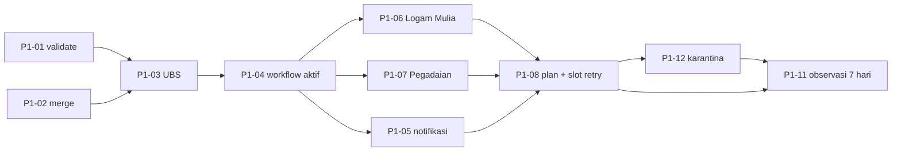

# Fase 1 — Pipeline harga ritel

| | |
| --- | --- |
| **Tujuan** | Mengumpulkan harga jual dan buyback harian dari UBS Lifestyle, Logam Mulia, dan Pegadaian secara otomatis, tervalidasi, dan teraudit |
| **Bergantung pada** | G0 |
| **Perkiraan usaha** | 5–7 hari kerja + 7 hari observasi |
| **Gerbang keluar** | **G1** |

## Ruang lingkup

**Masuk:** validasi, merge/upsert, arsip mentah, log run, tiga scraper ritel, workflow terjadwal, slot ulang, notifikasi, backfill UBS (bila endpoint ada).

**Tidak masuk:** data makro (Fase 2), web (Fase 3), tabel gramasi Antam LM (Fase 4), perintah `reparse` (Fase 5).

## Urutan kerja

Aktifkan pengumpulan data **secepat mungkin**: selesaikan inti pipeline + scraper UBS, langsung jalankan workflow terjadwal, lalu tambahkan Logam Mulia dan Pegadaian ke matrix.

## Tugas

### Inti pipeline

- [x] **P1-01** `validate.ts`: aturan V-01 s.d. V-07 dan V-11 (TECH-SPEC §7), membedakan tingkat **run** (gagalkan sumber) dan **baris** (karantina). Setiap aturan punya uji lolos dan gagal. — `FR-10` · M
  - *26 Okt 2026:* `apps/scraper/src/pipeline/validate.ts`; uji lolos/gagal per aturan di `test/validate.test.ts`. V-01 juga menolak kunci ganda; "tahun berjalan" UBS = tahun produksi terbaru (D-22).
- [x] **P1-02** `merge.ts` sesuai DATA-MODEL §5: insert / unchanged (tidak disentuh) / update + `REVISION`; ketiadaan ≠ hapus; urutan stabil; raw dengan dedupe sha256; tulis karantina, `runs/{yyyy}.jsonl`, `status.json`; hasilkan `summary.json` dan pesan commit. Uji: merge 2× = tanpa diff Git. — `FR-11`, `FR-12`, `FR-16`, `NFR-03`, `NFR-05` · L
  - *26 Okt 2026:* `pipeline/merge.ts` + `store.ts` + `upsert.ts`; mendukung `--origin` dan `--dry-run` (dipakai P1-13). Uji di `test/merge.test.ts` dan `test/scrape.test.ts` (scrape → merge 2× = CSV sama). RUN tidak digandakan untuk `run_id` yang sama (D-22).

### Scraper

- [x] **P1-03** **UBS Lifestyle** (`ubslifestyle.ts`): semua tabel tahun produksi → `variant`; "Harga Beli" → `sell_price`, "Harga Jual (Buyback)" → `buyback_price`; `data_date` dari endpoint grafik `chart_interval/GOLD/7` bila cocok dengan buyback 1 g, `source_updated_at` kosong, deteksi `stale` (TECH-SPEC §5.1, D-19). Uji dengan fixture Fase 0. — `FR-01`, `D-08` · M
  - *26 Okt 2026:* `sources/ubslifestyle.ts` (parserVersion `ubslifestyle@1.0.0`), raw = semua `<table>` + respons grafik (D-22); perintah `scrape` di `pipeline/scrape.ts`. Uji fixture di `test/ubslifestyle.test.ts`. Uji nyata 26 Okt 08.30 WIB: `stale` (data Sabtu) di hari yang diharapkan → kode 3, sesuai rancangan.
- [ ] **P1-06** **Logam Mulia** (`logammulia.ts`) sesuai TECH-SPEC §5.3: Playwright + stealth, token CSRF, dua endpoint, titik terakhir per hari, `location = jakarta`, aturan V-07. Run pertama mengisi histori sejak 2010: baris dengan tanggal sebelum run pertama ditandai `origin = backfill`. Gagal keras bila diblokir; tidak ada sumber pengganti. — `FR-03`, `D-06`, `D-10` · L
  - *26 Okt 2026:* **tertahan (D-24).** Situs versi baru: API terenkripsi, Akamai menolak akses otomatis tanpa stealth. Tidak di-scrape; harga-emas.org dievaluasi dan belum layak. Kriteria "histori sejak 2010" dicabut; bila ada akses resmi, `sell_price` = Harga Dasar.
- [x] **P1-07** **Pegadaian** (`pegadaian.ts`): jalur utama `GET /gold/prices/table`, brand lewat `idVendor`, vendor lain diabaikan, `hargaJual = 0` dibuang (TECH-SPEC §5.2, D-20); fallback Playwright membaca DOM. Buyback selalu kosong (Q-1). — `FR-02`, `D-07` · M
  - *26 Okt 2026:* `sources/pegadaian.ts` (parserVersion `pegadaian@1.0.0`), uji `test/pegadaian.test.ts` dengan tiga fixture. Uji nyata: harga Minggu terbit Sabtu malam (periode I) → kalender tetap `daily`. Fallback Playwright ditunda (D-23). Diaktifkan di `config/sources.yml`.

### Otomasi dan operasi

- [x] **P1-04** Workflow `scrape-retail.yml` persis WORKFLOWS §3.2: job `plan → scrape (matrix) → merge → notify`, kontrak artifact §2.1, kode keluar §2.3, push dengan `pull --rebase` + retry, `concurrency: data-write`. Aktifkan segera setelah P1-03 dengan hanya `ubslifestyle` diaktifkan di `sources.yml`. — `FR-09`, `NFR-04` · M
  - *26 Okt 2026:* `.github/workflows/scrape-retail.yml` persis WORKFLOWS §3.2; `ubslifestyle` diaktifkan di `config/sources.yml`. Bergantung pada `plan` (P1-08, sudah diimplementasikan) dan `notify` (sementara hanya step summary, P1-05).
- [ ] **P1-05** `notify.ts` sesuai tabel WORKFLOWS §4: step summary, Telegram, Issue `pipeline-failure`/`quarantine` per sumber tanpa duplikat (komentar pada Issue terbuka), tutup otomatis saat pulih. — `FR-13` · M
  - *26 Okt 2026:* sebagian — `notify` menulis tabel step summary (`pipeline/notify.ts`). Belum: Telegram, Issue `pipeline-failure`/`quarantine`, tutup otomatis.
- [ ] **P1-08** Logika `plan` (WORKFLOWS §2.2): slot `primary` vs `retry` dari `github.event.schedule`, input manual `sources`/`force`, kalender `update_calendar` + `holidays.yml` untuk menentukan hari yang diharapkan. — `FR-09`, `NFR-02` · M
  - *26 Okt 2026:* logika slot primary/retry/manual, `force`, dan kalender + `holidays.yml` sudah ada di `pipeline/plan.ts` + `calendar.ts` (uji `test/plan.test.ts`) karena dibutuhkan P1-04. Dicentang setelah slot retry terbukti di run terjadwal.
  - *26 Okt 2026:* jendela jadwal `day`/`evening` (`schedule_window`, `SCHEDULES`): Pegadaian pindah ke 19.05/21.05 WIB karena endpoint = snapshot harian ±18.32 WIB (D-25).
- [ ] **P1-09** *(P2)* Backfill histori UBS dari endpoint grafik bila Q-2 positif (`backfill --job ubs-history`, `origin = backfill`) lewat `backfill.yml`. — `FR-08` · M
- [ ] **P1-10** Bagian "Operasional" di README repo: menjalankan scrape manual, membaca `data/meta/runs/`, `status.json`, dan karantina, menangani Issue gagal, menambah sumber baru. — `NFR-05` · S
- [ ] **P1-12** Karantina: perintah `quarantine` + workflow `quarantine.yml` (WORKFLOWS §3.5); Issue `quarantine` berisi path dan cara memutuskan. — `FR-15` · M
- [ ] **P1-13** Workflow `backfill.yml` (WORKFLOWS §3.4) dengan `dry_run` default `true`; dipakai P1-09 dan Fase 2. — `FR-07`, `FR-08` · S
- [ ] **P1-11** Observasi 7 hari: cek hasil harian, perbaiki parser/validasi, catat insiden di DECISIONS.md bila mengubah aturan. Tetapkan `update_calendar` final tiap sumber (jawab **Q-6**). — `G1` · —

## Kriteria selesai

- Ketiga scraper berjalan di workflow terjadwal dan lulus uji fixture.
- ~~`data/prices/logammulia/` memuat histori jual sejak 2010 dan buyback sejak 2015.~~ Dicabut (D-24): situs baru tidak menyediakan histori panjang dan memblokir akses otomatis.
- Setiap kegagalan menghasilkan workflow merah, pesan Telegram, dan Issue.
- `data/meta/runs/{yyyy}.jsonl` dan `data/meta/status.json` terisi untuk setiap run; setiap perubahan nilai tercatat di `revisions/`.
- Menjalankan workflow manual dua kali di hari yang sama tidak mengubah CSV.

## Gerbang keluar G1

- **7 hari berturut-turut** run hijau untuk UBS Lifestyle dan Pegadaian (Logam Mulia: hijau, atau celahnya tercatat sesuai D-06).
- Tidak ada baris yang melanggar aturan V-xx di `data/prices/`.
- Ukuran folder `data/` bertambah sesuai perkiraan (< 30 KB per hari).

## Risiko dan catatan

- Bila runner GitHub diblokir Logam Mulia secara konsisten, evaluasi *self-hosted runner* (Q-4) sebelum menerima seri kosong.
- Cron GitHub sering terlambat 5–30 menit; jangan bergantung pada ketepatan waktu.
- Simpan jumlah titik histori Logam Mulia di `status.json` (`history_points`) untuk aturan "histori tidak menyusut".
